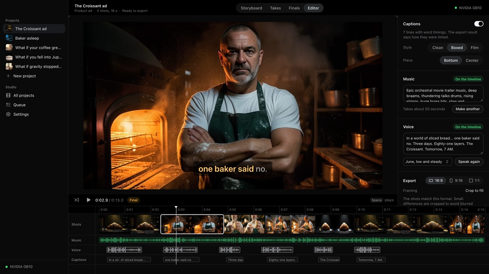
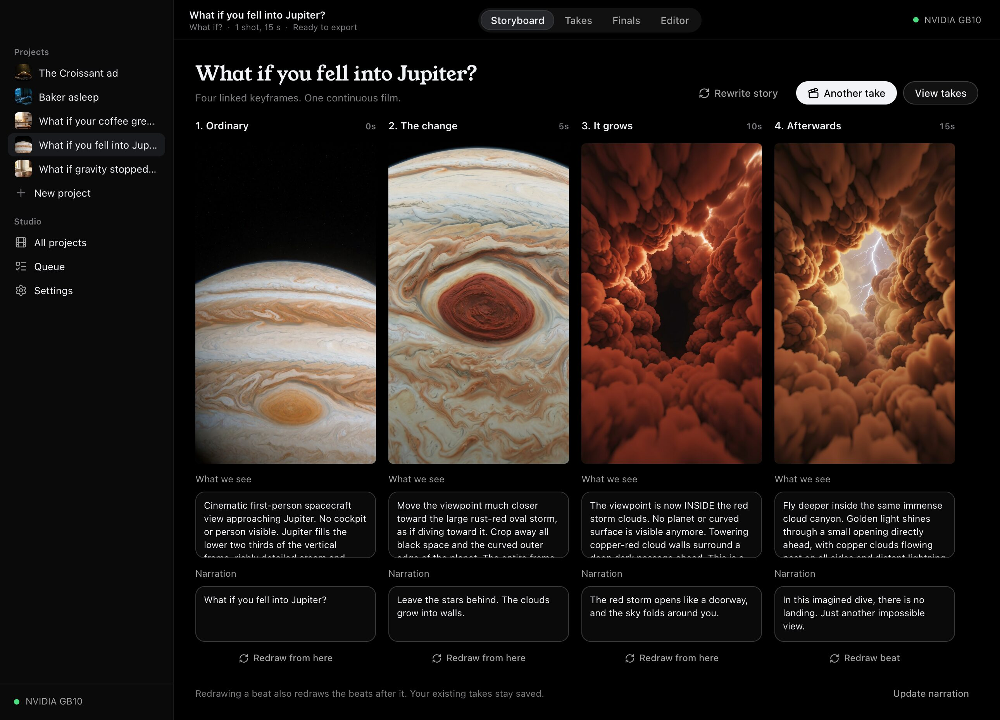
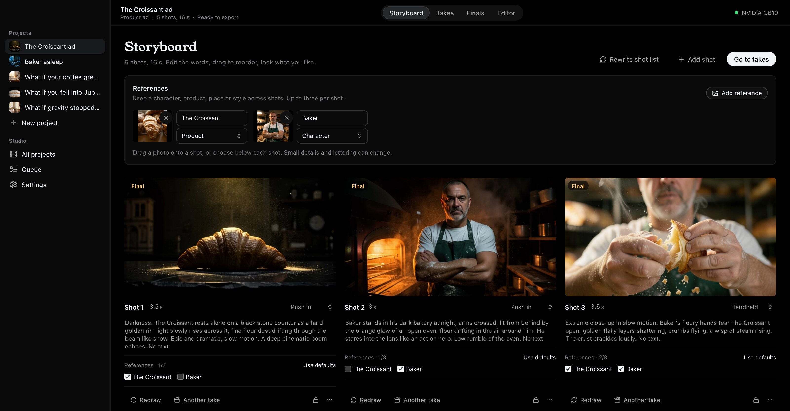
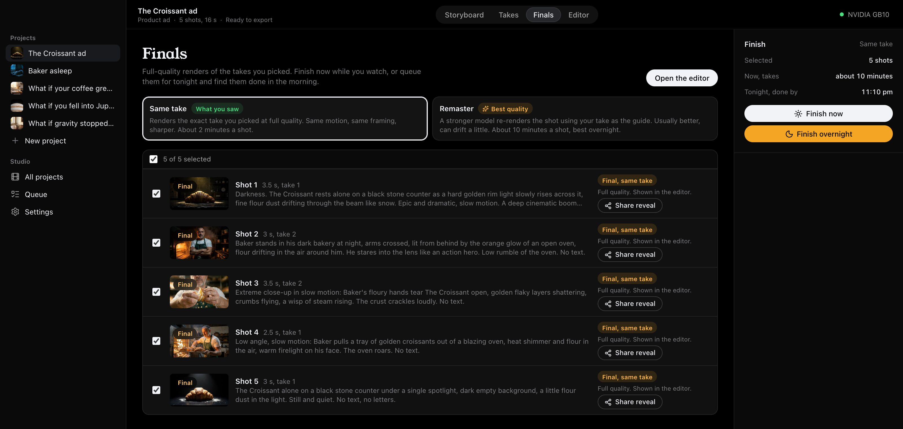
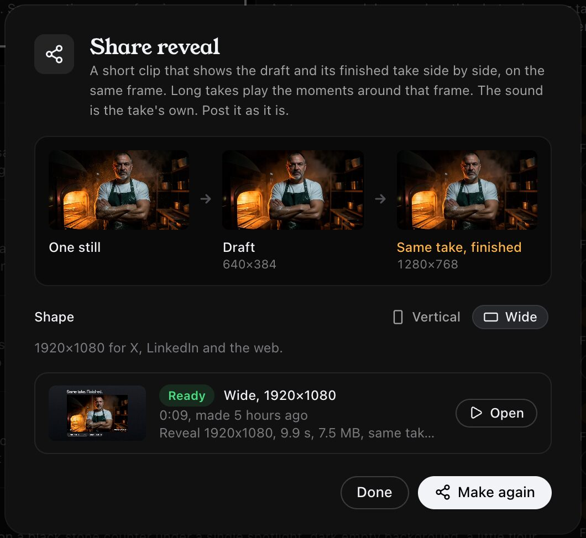
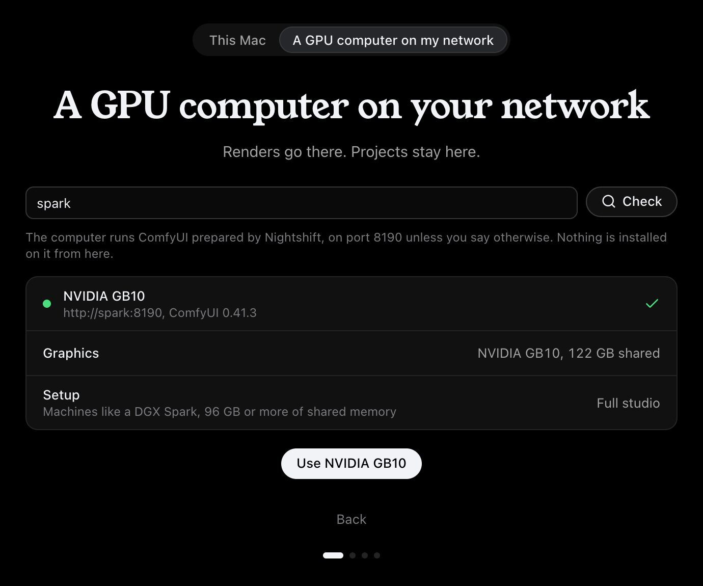
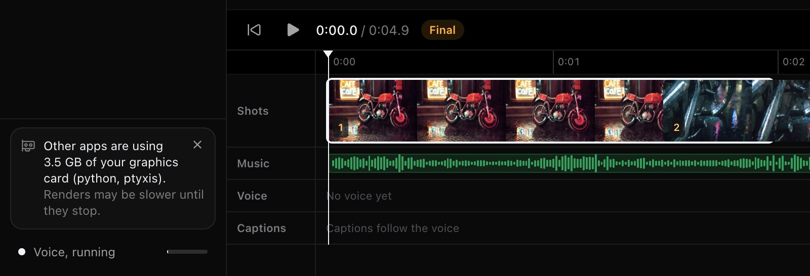
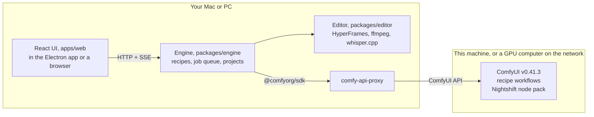

# Nightshift

**An AI video studio that runs on hardware you own. It sets itself up for your machine, makes quick drafts while
you work, and finishes the takes you picked overnight.**

Nightshift is an entry in Comfy's [Open Source Higgsfield](https://comfy.org/open-source-higgsfield) hackathon. Every
image, video, voice and music clip is made in ComfyUI on your own GPU, driven through the Comfy SDK. The code is
Apache-2.0.

<!-- Demo video: add the link here before publishing (docs/PUBLISHING.md). -->



<sub>The editor, with a 15-second product ad made in the app. Every shot, the voice and the music were rendered on a
DGX Spark on the same network as the Mac. The baker is a generated person, not a real one. The croissant reference is
a [photo by James Collington on Pexels](https://www.pexels.com/photo/30403209/). All screenshots here are the real
app on real projects.</sub>

## Why it is different

- **What if? One question becomes one continuous film.** Four linked keyframes carry an ordinary scene through an
  impossible change. LTX 2.5 makes a 15-second film with no edit between the beats. Narration, music and large
  captions arrive on the timeline. Redraw a beat, pick another take, then finish that same take overnight.
  Cinematic and Miniature world looks, with an optional opening photo. On the DGX Spark recipe.
  [Visual checks and limits](research/2026-10-28_what_if.md).
- **Draft by day, finish overnight.** Every shot climbs a ladder: a storyboard still in seconds, a motion draft in
  about a minute, then a final. The **same-take final** loads the saved LTX 2.5 latent of the draft you approved,
  video and sound, and finishes it at twice the resolution. It is the same take, not a new roll of the dice: on four
  real projects each final matched its draft frame by frame (SSIM 0.91 to 0.96 after downscaling) and its decoded
  audio was bit-identical. The **remaster** re-renders with MiniMax H3, guided by the draft, and the app says it may
  drift. Queue finals for tonight; the Mac stays awake and tells you when they are done.
- **Share reveal.** From the Finals page, a same-take final becomes a clip of 8 to 12 seconds, vertical or wide.
  The draft plays, freezes on one frame, and the finished take appears on that same frame, then plays on with its own
  sound. Every size and frame number on screen is read from the files. A remaster is never offered as a same-take
  proof.
- **It fits your machine.** Before it downloads anything, Nightshift reads your GPU, memory, disk and OS, then
  installs one of seven hardware recipes. Each recipe is its own model lineup, not one model squeezed down: Krea 2,
  LTX 2.5 and MiniMax H3 on a 128 GB DGX Spark; MOSS-Image and Kandinsky 6 Lite on an 8 GB card. Both ends are
  [tested on real hardware](#tested-hardware). A "leave room for other apps" slider turns into ComfyUI memory flags.
- **It says when another app is on the graphics card.** On a card with its own memory, another program can push
  the models out and slow every render, with nothing on screen to say why. In a local install, while a render runs,
  Nightshift asks `nvidia-smi` who else holds the card and shows a quiet note with the apps and how many GB they hold. If a voice or
  song fails because the card ran out of memory, the editor says so in plain words.
- **Use a GPU computer on your network from a Mac.** Projects, editing and exports stay on the Mac. Every render runs
  on a Linux NVIDIA computer with Nightshift's ComfyUI. The app reads that computer's hardware, picks its recipe,
  lists any node or model it lacks, and waits out dropped connections without starting a job twice.
- **Reference photos across shots.** Name a character, product, place or style once, then choose up to three
  references per storyboard still. In the Spark tests, the Solenne bottle and an illustrated character stayed
  recognizable across different compositions. Small details, lettering and skin tone can still drift.
  [Visual checks](research/2026-10-21_references.md).
- **Idea to finished video in one app.** Five templates (What if?, cinematic shot, music video, product ad, talking intro)
  write a shot list with a local LLM, draw stills, make drafts, add voice, music and word-timed captions, and export
  MP4 in 16:9, 9:16 and 1:1.
- **A camera move from one photo.** On the Spark, pick a camera path for a four-second shot. MoGe estimates
  depth, an explicit camera renders the layout, and LTX 2.5 turns it into video. Compare takes and finish the
  same take through the usual editor and export flow.
- **An effect from one photo.** Ten LTX 2.5 effects: Disintegrate, Freeze, Ignite, Melt, Shatter, Bloom, Solid gold,
  Crystallize, Levitate and Earth zoom out. For an effect with an end state, FLUX.2 Klein 4B edits the photo into
  the after image, and LTX 2.5 moves from one to the other in a four-second shot. Then the same take finishes and
  exports like any other. Tested on the Spark. [Effect tests](research/2026-10-21_vfx_effects.md).

## In the app

**What if?** Four linked keyframes, then one continuous 15-second take.



**The storyboard, with references.** The croissant photo and the baker are references; each shot picks its own.



**Finals, now or tonight.** Pick the same take or a remaster. With every shot ticked, the panel says when tonight's
run would be done. Nothing is queued until you press a button.



**Share reveal.** The draft and its finished take, on the same frame.



**A GPU computer on the network.** Nightshift checks it, reads its GPU and picks its recipe. Nothing is installed on
it from the Mac.



**Another app on the graphics card.** A real capture from the RTX 2080 Super test, while a speech service held
3.5 GB of the 8 GB card.



## Tested hardware

Two machines have run Nightshift end to end. The other five tiers are estimates, and the app labels them so.

**NVIDIA DGX Spark** (GB10, 128 GB unified memory), as a GPU computer on the network of an M4 Max Mac, with the
`unified-128-cuda` recipe. Every Spark project in this README was made this way, through the app. Times are in
[Hardware tiers](#hardware-tiers). A 15-second What if? draft took 146 s and its same-take final 278 s
([measurements](research/2026-10-28_what_if_measurements.json)).

**NVIDIA RTX 2080 Super** (8 GB, Turing), in a Linux PC with an i7-7700 and 30 GB of RAM, with the `nvidia-8`
recipe. A local install, driven through the web UI. A fresh install, the First shot sample, a three-shot project with
a second take, same-take finals, music, voice, word-timed captions and a 1080p export all worked. No model needed a
token. Nothing ran out of memory while Nightshift had the card to itself.

| Step on the RTX 2080 Super | Time | Peak VRAM |
|---|---|---|
| Install: Python, ComfyUI and node packs | 3.5 min | |
| Install: 56 GB of models | 47.5 min, at about 20 MB/s | |
| Shot list (Qwen3-VL 4B), one shot / three shots | 209 s / 483 s | 5.3 GB |
| Storyboard still, 960x640 (MOSS-Image) | 141 to 142 s | 6.8 GB |
| Motion draft with sound, 384x256, 49 frames (Kandinsky 6 Lite) | 47 to 55 s (63 s cold) | 7.1 GB |
| Same-take final, 768x512 | 1.4 to 1.8 s | 0.3 GB |
| Music, a 5 s cue (ACE-Step 1.5 turbo) | 37.5 s | 6.7 GB |
| Voice, a 4.4 s line (Breeze TTS 2) | 23 s | 4.4 GB |
| 1080p export, captions timed to the words | 23 s | CPU |

An 8 GB card is good for storyboards and animatics. The stills are strong. The drafts are rough. They are 384x256,
at most about 2 s a shot, and close mechanical detail can melt, as it did in one draft of three. The final on this
tier is a 2x resize of the same take, with the same motion and sound but no new detail. With another app holding 1.7 GB of the
card, stills ran 14 to 24% slower. With 3.5 GB taken, the voice ran out of memory; it worked once the card was free.

The test also found two bugs, both now fixed. A transformers release from 2026-10-26 broke the voice on every fresh
install, on every tier, so the installer now holds transformers below 5.21. And captions could swap two words when
they were snapped to the voice.

## How it uses ComfyUI and the Comfy SDK

All generation goes through the Comfy SDK. The engine has no other way to reach the GPU, and app code makes no raw
`/prompt` calls.



- A **recipe** (`recipes/*.json`) names the models, ComfyUI launch flags, node packs and one API-format workflow per
  step: shot list, still, draft, same-take final, remaster, voice, music.
- For each step the engine loads the workflow from `workflows/`, fills its named inputs (prompt, seed, size,
  frames, image, latent, voice) using the sibling `.ref.json`, and runs it with `@comfyorg/sdk`:
  `workflows.fromJson`, inputs uploaded as SDK assets, `submit`, live progress from the job's events, and only the
  declared output nodes downloaded. After a restart it finds its ComfyUI job again (`jobs.get`) instead of running
  it twice.
- [comfy-api-proxy](https://github.com/Comfy-Org/comfy-api-proxy) 0.1.6 puts Comfy's API in front of ComfyUI. The
  engine runs it next to itself, so the GPU computer only needs ComfyUI.
- Our node pack, `comfy_nodes/nightshift`, adds what core ComfyUI lacks: saving and loading LTX's joint audio-video
  latent (`NightshiftSaveAVLatent`, `NightshiftLoadAVLatent`), which makes same-take finals possible; copying the
  draft's audio packets into the final (`NightshiftSaveVideoPreserveAudio`); and returning the LLM's shot list as a
  downloadable asset (`NightshiftSaveText`). Three community packs (Breeze TTS 2, MOSS-Image, Kandinsky 6) are
  pinned to commits and patched where needed.
- The model-lab scripts in `scripts/` use the Python `comfy-sdk` the same way. Their measurements are in
  `research/`.

| Package | What it is |
|---|---|
| `packages/contract` | zod schemas and HTTP routes shared by the engine, UI and shell |
| `packages/engine` | Local server: hardware probe, recipes, installer, ComfyUI and proxy processes, job queue, projects ([README](packages/engine/README.md)) |
| `packages/editor` | Timeline, template compositions, captions, sound mix and MP4 export ([README](packages/editor/README.md)) |
| `apps/web` | The React UI. The engine serves it in a browser too |
| `apps/desktop` | Electron shell: runs the engine, native notifications, keep-awake overnight, Mac build ([README](apps/desktop/README.md)) |
| `recipes/`, `workflows/` | Seven hardware recipes and their ComfyUI graphs ([README](workflows/README.md)) |
| `comfy_nodes/` | Nightshift's ComfyUI node pack and node-pack installer |

## Run it

Step-by-step instructions, and what was tested for each path, are in **[docs/SETUP.md](docs/SETUP.md)**.

| Path | What you need | Tested |
|---|---|---|
| Demo mode | Any Mac or Linux with Node 22. No GPU, nothing downloaded | Yes, in a browser and in the Mac app |
| Mac app with a GPU computer on the network | Apple Silicon Mac, and a Linux NVIDIA computer prepared with `scripts/setup_comfyui.sh` | Yes, with a DGX Spark |
| Local install on one machine | Apple Silicon Mac or Linux NVIDIA computer, 56 to 146 GB of downloads | Yes, on Linux with an RTX 2080 Super (`nvidia-8`), from install to export. Not on a Mac |
| Build from source | Node 22, pnpm 10, uv; macOS for the app | Yes |

The quickest look, with no GPU:

```sh
npx pnpm@10.33.0 install --frozen-lockfile && npx pnpm@10.33.0 build
node packages/engine/dist/cli.js --mock --data-dir /tmp/nightshift-demo --web-dir apps/web/dist
# open http://127.0.0.1:8740
```

## Models

Each recipe records every file it downloads with a pinned URL, size, SHA256 and license. Tiers are the recipe names
in the next section.

| Model | Used for | Tiers | License | Commercial use |
|---|---|---|---|---|
| [LTX 2.5](https://huggingface.co/Lightricks/LTX-2.5) 22B distilled (int8 or bf16), with its Gemma 4 12B text encoder, VAEs and 2x latent upscaler | Motion drafts with sound, and same-take finals | unified-128-cuda, apple-64, nvidia-32, nvidia-24-offload, nvidia-12-offload | [LTX-2.x Community License](https://github.com/Lightricks/LTX-2/blob/main/LICENSE-2_x) | Free below $10M annual revenue; a paid license above. Outputs must be labeled AI-generated. Gated download |
| [MiniMax H3](https://huggingface.co/MiniMaxAI/MiniMax-H3) Ref2VA (pruned int8), a 4-step turbo LoRA, Qwen3-VL 32B encoder (NVFP4 or int8) | Remaster finals | unified-128-cuda, nvidia-32, nvidia-24-offload | [MiniMax H3 Community License](https://huggingface.co/MiniMaxAI/MiniMax-H3/blob/main/LICENSE) | Its territory excludes the US, EU, UK and South Korea; use there needs MiniMax's permission. Elsewhere allowed with conditions: show "MiniMax H3" in a commercial UI, permission above $20M revenue, disclose machine-generated output |
| [Krea 2 Turbo](https://huggingface.co/Comfy-Org/Krea-2) (bf16, int8 or NVFP4), Qwen3-VL 4B encoder, Qwen-Image VAE | Storyboard stills | unified-128-cuda, apple-64, nvidia-32, nvidia-24-offload | [Krea 2 Community License](https://www.krea.ai/krea-2-licensing) | Free below $1M total revenue; an enterprise license above |
| [FLUX.2 Klein 4B](https://huggingface.co/black-forest-labs/FLUX.2-klein-4b-fp8) (fp8), Qwen3 4B encoder, FLUX.2 VAE | Stills from up to three reference photos | unified-128-cuda, nvidia-32, nvidia-24-offload | Apache-2.0 | Allowed |
| [MOSS-Image](https://github.com/OpenMOSS/MOSS-Image) 5B (int8), Qwen3.5 9B encoder (int8 or GPTQ) | Storyboard stills | nvidia-12-offload, nvidia-8, apple-16 | Apache-2.0 | Allowed |
| [Kandinsky 6 Lite](https://huggingface.co/kandinskylab/Kandinsky-6.0-Lite-distill-5s-Diffusers), with Qwen2.5-VL 7B, CLIP-L, Hunyuan video VAE, MMAudio audio VAE, BigVGAN | Motion drafts with sound | nvidia-8, apple-16 | MIT, but the MMAudio VAE is CC BY-NC 4.0 and the Hunyuan VAE is under Tencent's community license | Not for commercial use (MMAudio VAE). The Hunyuan license also excludes the EU, UK and South Korea |
| [Breeze TTS 2](https://huggingface.co/BreezeBlue/Breeze-TTS-2) (int8 hybrid) | Voiceover | every tier | [BreezeBlue Research and Non-Commercial License](https://huggingface.co/BreezeBlue/Breeze-TTS-2/blob/main/LICENSE); the ComfyUI node is Apache-2.0 | Not for commercial use, including the generated audio |
| [MiniMax Music 3](https://huggingface.co/MiniMaxAI/MiniMax-Music3) (fp16 DiT, int8 text encoder) | Songs and background music | unified-128-cuda, nvidia-32 | [MiniMax-Music3 Community License](https://huggingface.co/MiniMaxAI/MiniMax-Music3/blob/main/LICENSE) (Comfy's repack says Apache-2.0; we follow the upstream terms) | Allowed with conditions: show "MiniMax-Music3" in a commercial UI, permission above $20M revenue, disclose machine-generated output |
| [ACE-Step 1.5](https://huggingface.co/ACE-Step/Ace-Step1.5) turbo | Songs and background music | apple-64, apple-16, nvidia-24-offload, nvidia-12-offload, nvidia-8 | Apache-2.0 | Allowed |
| [Qwen3-VL 4B Instruct](https://huggingface.co/Qwen/Qwen3-VL-4B-Instruct) (fp8 or bf16) | Writing the shot list, locally | every tier | Apache-2.0 | Allowed |
| [Whisper](https://huggingface.co/ggerganov/whisper.cpp) large-v3-turbo or small.en (ggml) | Word timings for captions | every tier (on the machine that exports) | MIT | Allowed |
| [Silero VAD](https://github.com/snakers4/silero-vad) v6.2 (ggml) | Finding speech for caption timing | every tier (on the machine that exports) | MIT | Allowed |

**Several of these licenses restrict commercial use.** Breeze TTS 2 and the MMAudio VAE are non-commercial. LTX 2.5,
Krea 2, MiniMax H3, MiniMax Music 3 and the Hunyuan VAE are community licenses with revenue limits, labeling rules
or territory limits. The Nightshift code is Apache-2.0, but a video made with the default models is not
automatically cleared for commercial use. Read each license before you publish what you make. Comfy staff
confirmed that downloadable weights under restricted licenses count as open weights for this contest.

Evaluated and not shipped: Fish Audio DRAMA-3 (restricted code and weights, no quality gain over Breeze), Krea 2 Raw
(slower, no gain over Turbo), two other H3 turbo LoRAs (LightX2V 8-step, Joyfox 4-step), and a third-party Krea
int8 mix whose uploader forbids derivatives. The full record is in
[research/2026-10-19_model_lab.md](research/2026-10-19_model_lab.md).

## Hardware tiers

Nightshift picks a tier from GPU memory and system memory together, so a small card with lots of RAM gets an
offload recipe. Two tiers are measured: the DGX Spark, and nvidia-8 on an RTX 2080 SUPER
([measurements](research/2026-10-29_nvidia8_measurements.json)). The others are estimates from the Spark numbers, file
sizes and memory bandwidth ([napkin math](research/2026-10-19_napkin_math.md)), and the app labels them "estimated".

| Tier | Example | Still / draft / final models | Download | Still, draft, same-take final, remaster | Status |
|---|---|---|---|---|---|
| unified-128-cuda | DGX Spark (GB10, 128 GB unified) | Krea 2 bf16 / LTX 2.5 int8 / same take or H3 remaster; Music 3 | 146 GB | 31 s, 56 s, 81 s, 10 min | **Tested** |
| apple-64 | Apple Silicon, 64 GB or more | Krea 2 bf16 / LTX 2.5 bf16 / same take; ACE-Step | 122 GB | ~50 s, ~2 min, ~4 min, none | Estimated |
| nvidia-32 | RTX 5090 | Krea 2 NVFP4 / LTX 2.5 int8 / same take or H3; Music 3 | 127 GB | ~15 s, ~25 s, ~45 s, ~3.5 min | Estimated |
| nvidia-24-offload | RTX 4090 or 3090 with 64 GB RAM | Krea 2 int8 / LTX 2.5 int8 offloaded / same take or H3; ACE-Step | 140 GB | ~25 s, ~40 s, ~80 s, ~6 min | Estimated |
| nvidia-12-offload | 12 to 16 GB card with 64 GB RAM | MOSS-Image / LTX 2.5 int8 heavily offloaded / same take; ACE-Step | 76 GB | ~2 min, ~2 min, ~3.5 min, none | Estimated |
| nvidia-8 | 8 to 16 GB card with 16 GB RAM, like an RTX 2080 Super | MOSS-Image / Kandinsky 6 Lite / 2x pixel upscale; ACE-Step | 56 GB | 141 to 142 s, 47 to 55 s, under 2 s, none | **Tested** on an RTX 2080 Super |
| apple-16 | Apple Silicon, 16 to 32 GB | MOSS-Image / Kandinsky 6 Lite / 2x pixel upscale; ACE-Step | 63 GB | ~9 min, ~24 min, seconds, none | Experimental estimate |

The DGX Spark times are single cold jobs through the SDK, with model loading: a 768x768 still, a 640x384 draft of
97 frames (4 s at 24 fps) with sound, its 1280x768 same-take final, and a 1280x768 H3 remaster. In the four real
projects made through the app on the same Spark, shared with other work, a shot list took 4 to 11 s, stills 9 to
21 s, drafts 46 to 139 s, same-take finals 60 to 91 s (one that waited through a runtime restart took 288 s),
remasters 4 to 7 minutes, a voice line 7 to 40 s and a song 25 to 147 s. 1080p exports took 8 to 46 s on the Mac.
Every job is in [docs/qa/real/job_timings.json](docs/qa/real/job_timings.json).

The RTX 2080 Super times are from the local test in [Tested hardware](#tested-hardware), with the card to itself: a
960x640 still, a 384x256 draft of 49 frames with sound, and its 768x512 same-take final. The `nvidia-8` recipe
carries these measured times, so the app calls this tier tested.

## Third-party tools

| Tool | Role | License |
|---|---|---|
| [ComfyUI](https://github.com/Comfy-Org/ComfyUI) v0.41.3 | Runs every model. Installed by the app or `scripts/setup_comfyui.sh`, run as its own process | GPL-3.0 |
| [comfy-api-proxy](https://github.com/Comfy-Org/comfy-api-proxy) 0.1.6 | Comfy's API in front of ComfyUI | MIT |
| [@comfyorg/sdk](https://www.npmjs.com/package/@comfyorg/sdk) 0.5.0, [comfy-sdk](https://pypi.org/project/comfy-sdk/) | Submitting workflows from the engine and the lab scripts | MIT |
| Node packs: [ComfyUI-Breeze-TTS-2](https://github.com/Saganaki22/ComfyUI-Breeze-TTS-2), [MOSS-Image](https://github.com/OpenMOSS/MOSS-Image), [kandinsky-6](https://github.com/kandinskylab/kandinsky-6) | Voice, small-tier stills and video, pinned per recipe | Apache-2.0, Apache-2.0, MIT |
| [HyperFrames](https://github.com/heygen-com/hyperframes) 0.8 | Renders the editor's HTML compositions (titles, captions, cards) to video | Apache-2.0 |
| Chrome headless shell, through [@puppeteer/browsers](https://github.com/puppeteer/puppeteer) | The browser HyperFrames renders in | Chromium's BSD-style licenses; @puppeteer/browsers is Apache-2.0 |
| [FFmpeg](https://ffmpeg.org) | Trims, mixes, muxes and probes media. Run as a separate program, never linked. The Mac app bundles a Homebrew build with its license files | GPL (the bundled build enables GPL parts) |
| [whisper.cpp](https://github.com/ggml-org/whisper.cpp) | Word timings for captions, optional | MIT |
| [Silero VAD](https://github.com/snakers4/silero-vad) | Speech detection for caption timing | MIT |
| [uv](https://github.com/astral-sh/uv) | Installs Python 3.12, ComfyUI's environment and the proxy | Apache-2.0 or MIT |
| [PyTorch](https://pytorch.org) | ComfyUI's runtime | BSD-3-Clause |
| [Electron](https://www.electronjs.org) and electron-builder | The Mac app | MIT |
| React, Vite, zod | UI and schemas | MIT |
| [Fontsource](https://fontsource.org) fonts | Typefaces in the exported videos | OFL-1.1 |

`scripts/setup_comfyui.sh` can also install three packs that only one research graph uses
(`WITH_LAB_NODES=1`): ComfyUI-LTXVideo (LTX-2 Community License), ComfyUI-VideoHelperSuite and ComfyUI-KJNodes
(GPL-3.0). No recipe needs them and they are off by default.

## Known limits

- **Music is meant to be instrumental.** The form says songs have no sung lyrics, and the app asks for none. Even
  so, in one test MiniMax Music 3 sang in seven of eight 90-second songs. Orchestral prompts fared better.
- **Lettering drifts on products.** Photo-conditioned stills keep the product's shape and color but invent text and
  logos. The end card uses your original photo.
- **The portrait crop is a heuristic.** Turning a 16:9 shot into 9:16 follows the brightest, busiest area, which can
  miss the subject. The editor's "Whole picture, blurred background" framing is the fallback.
- **Two machines are tested.** The DGX Spark over the network, and an RTX 2080 Super with a local install. Local
  renders on a Mac are untested: the Apple recipes are estimates, and MPS support for LTX 2.5 and the quantized MOSS
  kernels is unproven. The other NVIDIA tiers are estimates too.
- **An 8 GB card makes animatics, not finished video.** Drafts are 384x256 and at most about 2 s a shot, and the
  final is a 2x resize of the same take: same motion and sound, no new detail.
- **A full graphics card fails some jobs.** The image and video models stream weights when another app holds part of
  the card, and run slower. The voice model cannot, so on an 8 GB card it can run out of memory next to another app.
  The app warns while it happens and says why a voice failed.
- **Same take is close, not pixel-identical.** On the LTX 2.5 tiers the final adds detail at the same framing and
  motion. On the 8 GB and Apple 16 GB tiers it is the draft upscaled to 2x, and adds no detail; the app says so. The
  remaster can change the subject; the app says so too.
- **Camera control depends on the template.** Camera move quick shots use an explicit path through estimated
  photo depth, with LTX Layout-To-Render following the resulting clip. Newly revealed surfaces can still deform,
  especially glass. Other templates use prompt guidance. See the [camera quality report](research/2026-10-21_camera_moves.md).
- **Shots are at most about 4 s** with LTX 2.5 (97 frames), and about 2 s with Kandinsky 6 Lite on the 8 GB and
  Apple 16 GB tiers (49 frames). Longer shots are trimmed to that, not extended.
- **The Mac app is not notarized.** It is ad-hoc signed and Apple Silicon only. A copy downloaded on another Mac
  will likely be blocked by Gatekeeper; that path is untested.
- **The GPU computer's ComfyUI has no password.** Keep port 8190 on a network you trust.

## Repository

```
apps/          web UI and Mac app
packages/      contract, engine, editor
recipes/       one JSON file per hardware tier
workflows/     ComfyUI API graphs, and upstream/ originals
comfy_nodes/   Nightshift's ComfyUI node pack
scripts/       ComfyUI setup, GPU-computer serving, model-lab tools
research/      model-lab notes and measurements
docs/          setup, plan, contest rules, design, QA records
```

Contributors and coding agents: see [AGENTS.md](AGENTS.md). The plan written during the build is
[docs/PLAN.md](docs/PLAN.md); the QA records in [docs/qa/](docs/qa/) include failures and how they were fixed.

## License

Nightshift's code is [Apache-2.0](LICENSE). The models and third-party tools keep their own licenses, listed above.
