# Export templates

How the videos Nightshift exports look. The four templates share one renderer (`packages/editor`, HyperFrames
compositions driven by `timeline.style`) but each has its own type, colour, cards and motion, so a cinematic shot, a
music video, a product ad and a talking intro are four different things, not one template with four palettes.

Stills in `exports/` come from `pnpm --filter @nightshift/editor samples -- --compose auto` on the first real
project's footage (LTX and H3 shots of the street, two plates from the cafe film) at 1600 px wide.

## Rules every template follows

**Safe areas.** Nothing of ours goes where the social apps draw their own controls. On 9:16 that is the top 13%,
the bottom 22% and the right 12% of the frame. On 16:9 and 1:1 it is a 6% margin. Captions, titles, name tags and
end card text all live inside these.

**The subject is a keep-out.** The focus finder that centres 9:16 crops also boxes the subject of every shot: from
the subject point it traces the patch of one colour around it (a red coat, a cup) in each of six sampled frames,
widens it for a head above and legs below, and keeps both the box per frame and the box over the whole clip. So a
figure that walks or grows is boxed where it is when a card shows. Text keeps a gap of 2% of the short side from
the box and never crosses it while a clear place exists.

- **Captions and lyrics** take one line for the whole film, so they do not jump. The block grows up from its line,
  so one line and two lines share a baseline. Three lines are tried in order: the look's usual line, the lowest
  line above the apps' controls, and a line just above the subjects' heads (the lowest head decides). The first
  that keeps every caption off its shot's subject wins; else the one that keeps the most caption time clear.
  Captions over a subject that fills the frame (a cup in close-up) cannot be clear anywhere and do not vote. If no
  caption can be clear, the old rule applies: the lower band, unless the subjects sit low. One exception: a shot
  whose captions would cross a standing figure (a box far taller than wide) on the film's line takes the next line
  that clears it, for all its captions, so the only switch is at that cut. Letterboxed film subtitles stay in the
  bar whatever the subject does.
- **A centred title** (cinematic, intro) takes the band above or below the subject, whichever has room, the larger
  when both do. It sits on the look's usual line, pushed only as far as it must to clear the subject and the
  captions (titles sit above captions). With no clear band it takes the lower band over a scrim rather than the
  face.
- **A name tag** goes on the side away from the subject at its usual height, narrowed so it stops short of the
  figure: the role wraps, the name shrinks a touch (never under 86%) to stay on one line. When that side is too
  narrow for its longest word it takes the full width below the subject, then just above the head, around the
  captions either way. With no clear place it keeps its spot over a stronger gradient.
- **Corner cards** (the song title, the product name) stop short of the subject on their side: beside a centred
  figure the song title stacks one word per line. Over a product that fills the frame the name stays in its corner
  with a scrim.

On the street footage this means: in 9:16 and 1:1 the figure walks down the middle to the bottom safe area, so
there is no clear band below her, and captions, lyrics and film subtitles sit just above her head in the sky. The
name tag sits beside her legs on the left with the role on two lines. In 16:9 the captions stay on their bottom
line, which clears her feet. In the product ad the cup and the cafe window set the film's line, and the one street
shot (the opening of the crash zoom) takes the line above her head for its own captions.

**Text reads on any footage.** Every clip comes with the brightness of 16 strips of the picture (measured inside
the crop, so a 9:16 crop between dark towers reads the sky). A soft full-width band, fading at both edges, darkens
behind a title, a caption block or a lyric when the picture there is bright: nothing over a dark road, 45% black
over a foggy sky, and at least 30% when a subject is under the text. The band behind captions shows only while
captions are up, holds through short gaps, and grows to each caption's own height. Captions carry no heavy stroke:
film subtitles and karaoke get a soft shadow, chip captions sit on a frosted plate and get no band, and lyrics are
heavy enough to carry their own weight, with a soft shadow.

Every caption look moves, timed to the spoken words, and each moves in its own way (`render/captions.ts`). A line
leaves before the next one arrives, so two lines never share a frame.

**Type scales with the frame.** Everything is sized in units of the short side (1% = 1 u). Text on a phone frame is
1.28 times bigger than the short side alone suggests, 1.12 on a square, because it is read at arm's length.

**Nothing shows before it starts.** Every card is hidden until its first frame; its parts animate in on their own.

**No GSAP, no network.** Compositions animate with the Web Animations API, which HyperFrames seeks frame by
frame. Fonts ship with the package (SIL Open Font License, via Fontsource).

## Cinematic shot

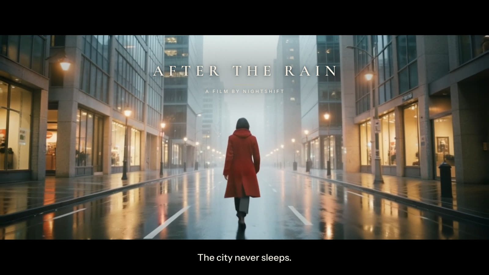

Film. The picture is letterboxed to 2.39 on 16:9 (full frame on 9:16 and 1:1), with a 35% vignette and light grain.

- **Title**: Cormorant Garamond 600 in tracked capitals (0.3 em), ivory, 5.6 u on 16:9, 6.2 u on a phone, 6 u on a
  square; a title of up to 18 characters shrinks to stay on one line. A 7 u amber hairline under it, then the credit
  line in Instrument Sans capitals tracked 0.36 em. It settles from a touch larger and out of focus over about two
  seconds. A full-width band behind the block (18% black at least, 45% over a bright sky) keeps the thin serif
  readable; the band fades over its top and bottom thirds. Band: the one with room, away from the subject (see
  above). On 16:9 the usual lines sit at 25% and 76% of the picture, on 9:16 at 27% and 56% of the frame.
- **Subtitles**: Instrument Sans 500, 3.5 u, in the lower letterbox bar on 16:9. On 9:16 and 1:1 they sit on the
  bottom line of the safe area (24% up on a phone, 9% on a square) with a soft shadow, or above the subject's head
  when the figure reaches the bottom of the frame. Each line comes in out of focus and settles, its words drawing
  in towards the middle, and drifts up out of focus when it goes. No word is singled out.
- **Cuts**: 0.5 s dissolves, a 0.6 s fade from black and a 0.9 s fade out. Dissolves overlap the shots, so each
  one shortens the film by half a second: a 4 + 4 + 3.5 s film runs 11 s. Set `transition.duration` to 0 for hard
  cuts.
- **Palette**: black, ivory `#F3EEE4`, amber `#E7B356`.

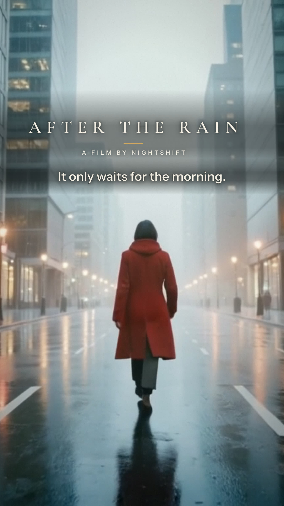

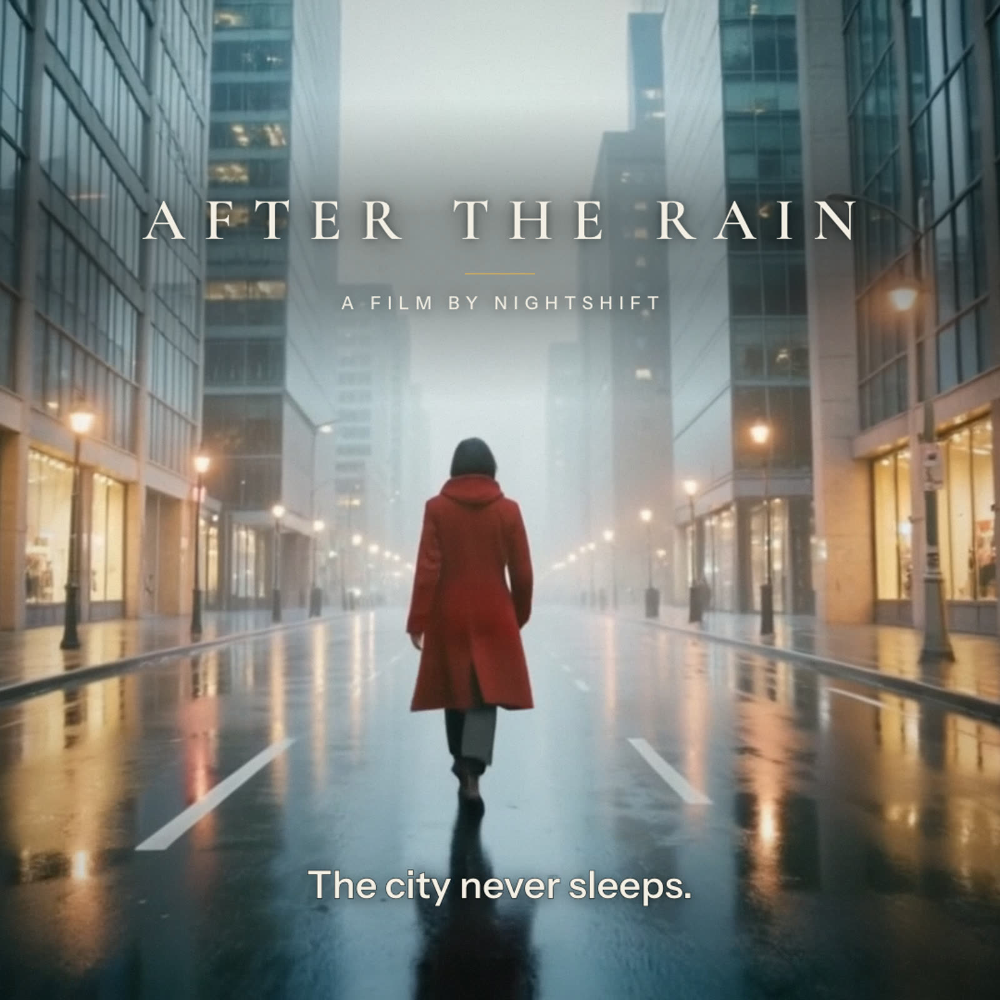

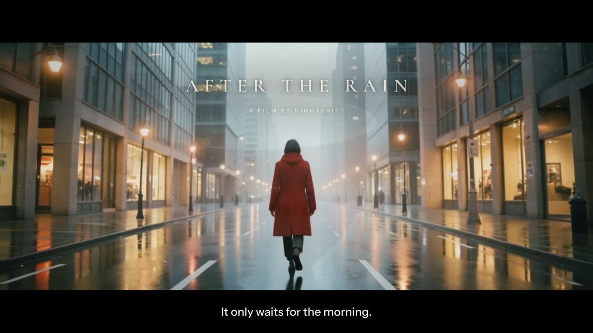

## Music video

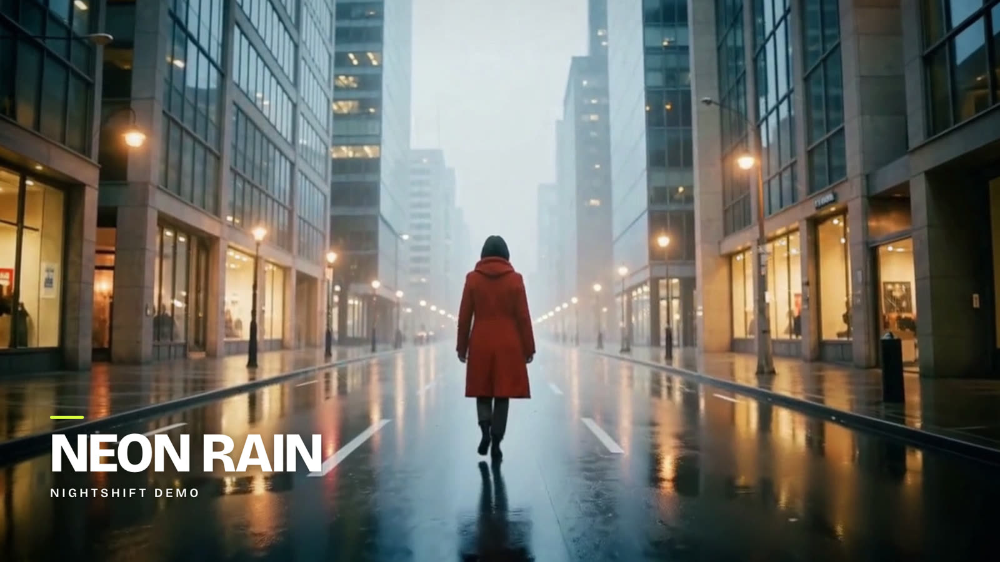

The way music channels credit a video, with lyrics that land on the words.

- **Song and artist**: bottom left, inside the safe area. A 6 u lime rule draws in, the title rises out of a clip
  in Bricolage Grotesque 800 capitals (10 u, 11 u on a phone), the artist under it in capitals tracked 0.22 em.
  Beside a centred figure the block stops short of her: the title stacks one word per line (each word shrinks to fit
  the column, never under three quarters) and the artist line shrinks to fit on one line.
- **Lyrics** (`kinetic`): Bricolage Grotesque 800 capitals at its narrowest width, 9.6 u. Each word lands as it is
  sung, settling from a little large and out of focus to sharp, lit in lime until the next word lands, then easing
  to white. The line lifts away out of focus when it ends. The block grows upwards from a fixed line, so a one line
  and a two line lyric share the same baseline: just under the middle of the frame when nothing is in the way, just
  above the subject's head when a figure fills the middle.
- **Motion**: hard cuts with a quick punch on each, a 2.5% pulse on every downbeat, a white flash where the song
  changes section.
- **Palette**: black, white, lime `#D9FF3F`.

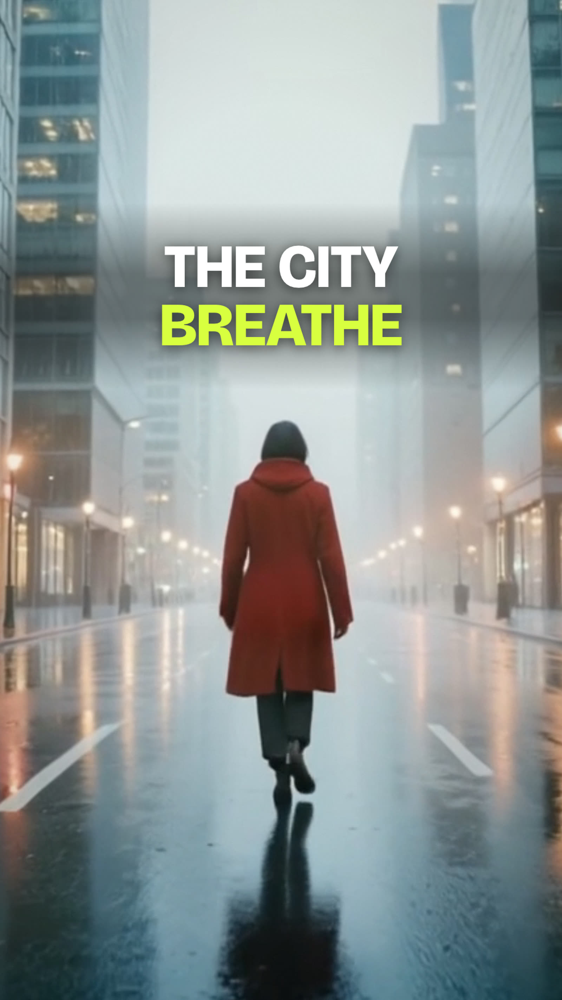

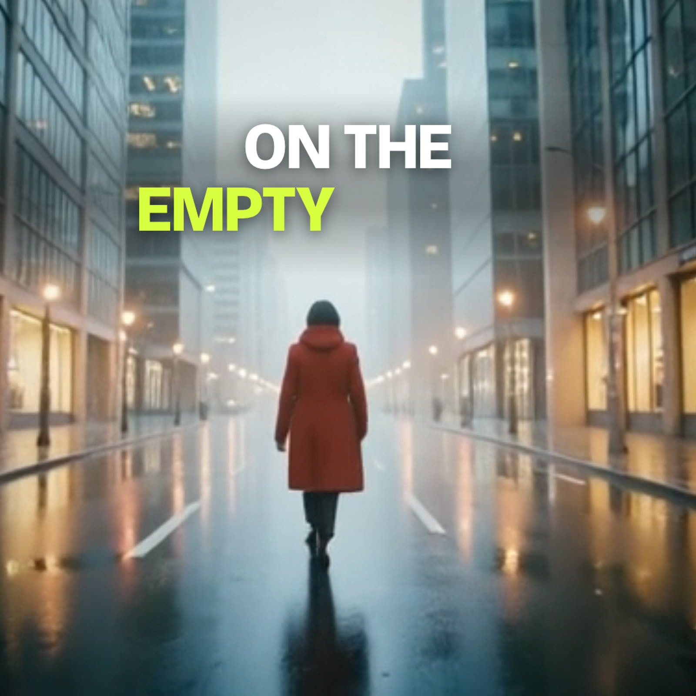

## Product ad

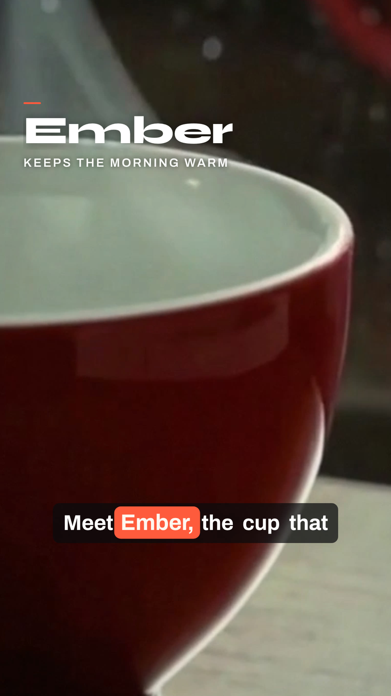

A commercial: a wide display name, captions in a pill, a split end card.

- **Name**: Syne 800 (9 u, 10 u on a phone) in a top corner, on the side away from the subject, with a coral rule
  above it and the tagline in Archivo capitals tracked 0.14 em. It stops short of a subject that leaves it room;
  over a product that fills the frame it stays in its corner with a scrim behind it.
- **Captions** (`chip`): Archivo 640, a little wide, 5 u, on a frosted dark plate that opens from the middle. One
  coral block slides from word to word as each is said, taking each word's width (measured in the page once the
  fonts are in); the word on it takes the text-on-accent colour. On the film's line (12% up on 16:9, 32% up on a phone), the
  lowest line, or above a figure's head, by the rules above. The pill needs no band.
- **End card**: fills the frame. The product photo takes the top 56% of a phone frame or the left 56% of a wide
  one; a coral panel takes the rest with the name in Syne (12 u), the tagline, and the call to action as a light
  pill. The panel slides in from below (from the right on 16:9), the name rises out of a clip, the pill pops. On a
  phone the panel's text stays above the bottom safe area; the panel colour runs under the apps' controls. Without a
  photo the panel takes the whole frame with the text centred.
- **Cuts**: hard, with a punch. The ad runs its promised 15 s (see the editor README).
- **Palette**: near black, white, coral `#FF5A3C` with cream `#FFF6F1` on it.

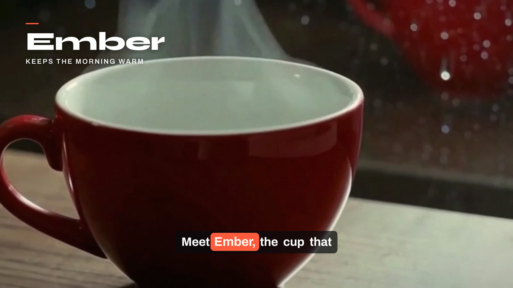

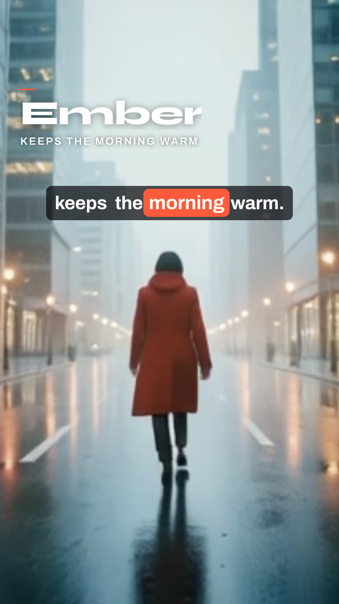

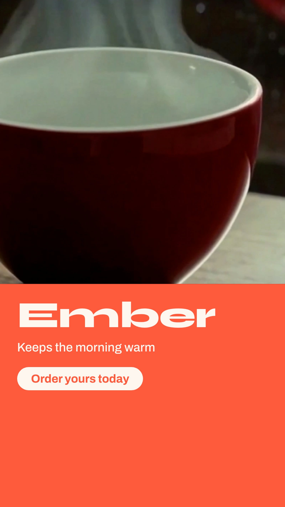

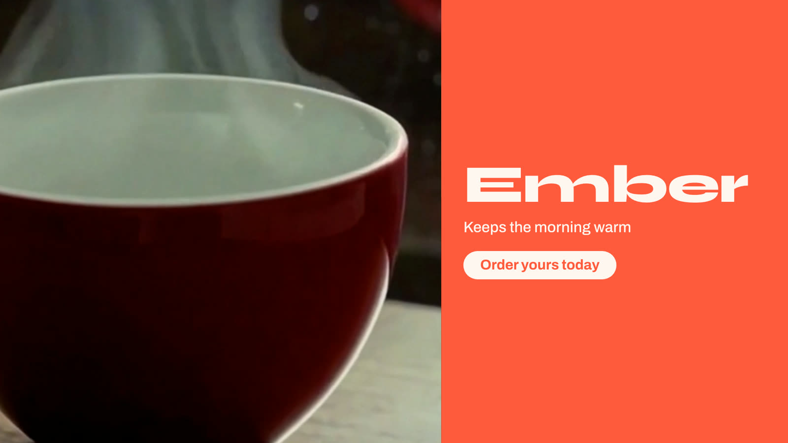

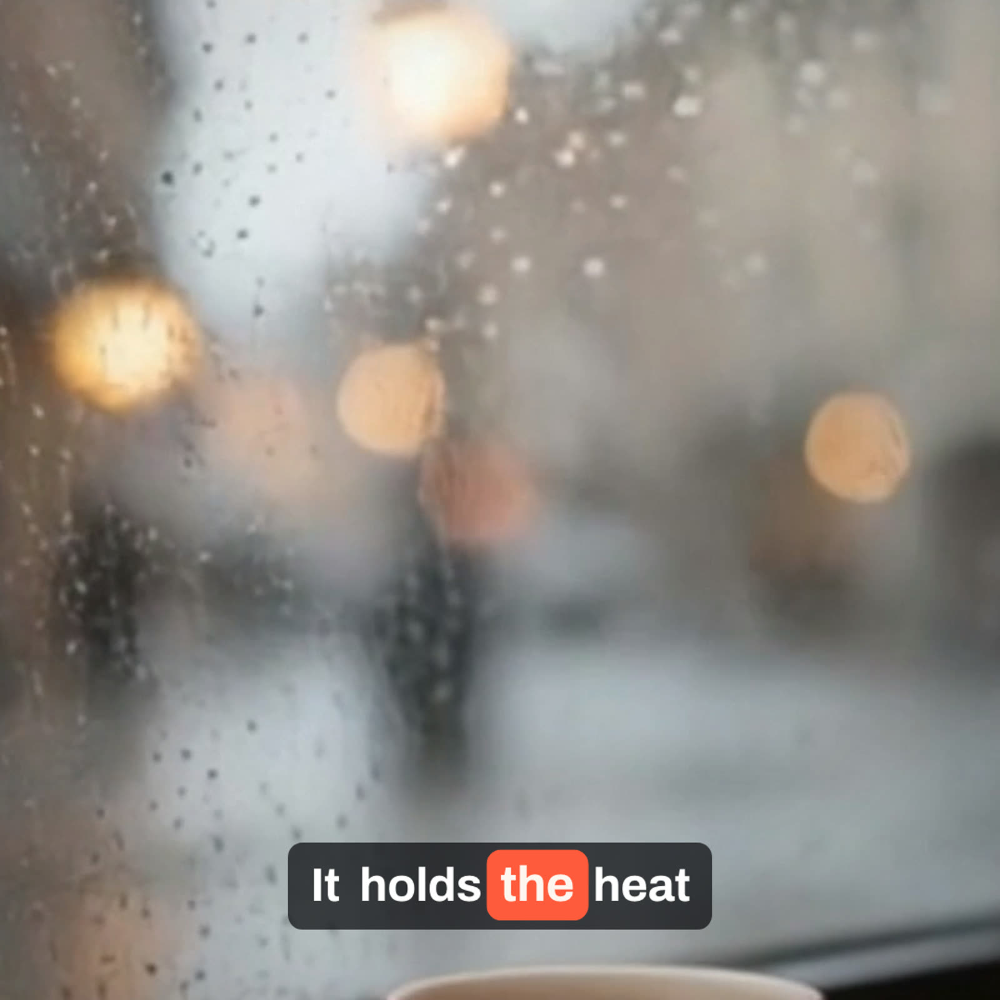

## Talking intro

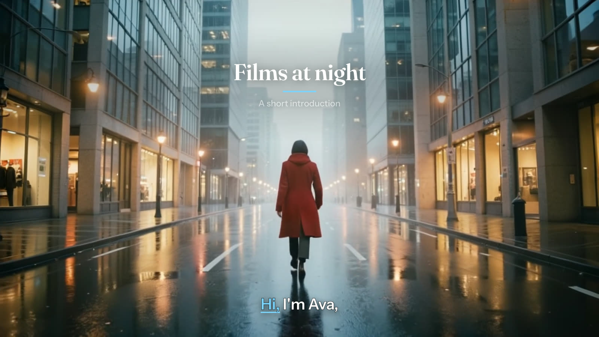

An explainer with an editorial voice.

- **Title**: Fraunces 600 (6.8 u, 8 u on a phone) centred in the band with room, away from the subject, a 10 u sky
  rule drawing under it, the subtitle in Instrument Sans, over a soft band when the sky behind is bright.
- **Name tag**: no box. A vertical sky bar grows down, the name slides out of it in Fraunces 600 (4.4 t), the role
  in Instrument Sans capitals tracked 0.1 em. A faint gradient behind it keeps it readable on bright footage. It
  sits on the side away from the subject, 24% up on 16:9 and 1:1, 23% up on a phone (just above the apps'
  controls), and stops short of the figure: beside a centred figure the role wraps to two lines.
- **Captions** (`karaoke`): Inter Display 700, tracked tight, 4.6 u (a size up on 16:9), with a soft shadow. Words
  rise into place through a mask, one after another. The accent sweeps across each word as it is said, then fades
  back to white as the next one starts, so the colour travels along the line. The words leave upwards through the
  same mask. Above the figure's head on a phone and a
  square, on the bottom line on 16:9.
- **Cuts**: 0.4 s dissolves, short fades.
- **Palette**: blue black `#0E1116`, white, sky `#7DD3FC`.

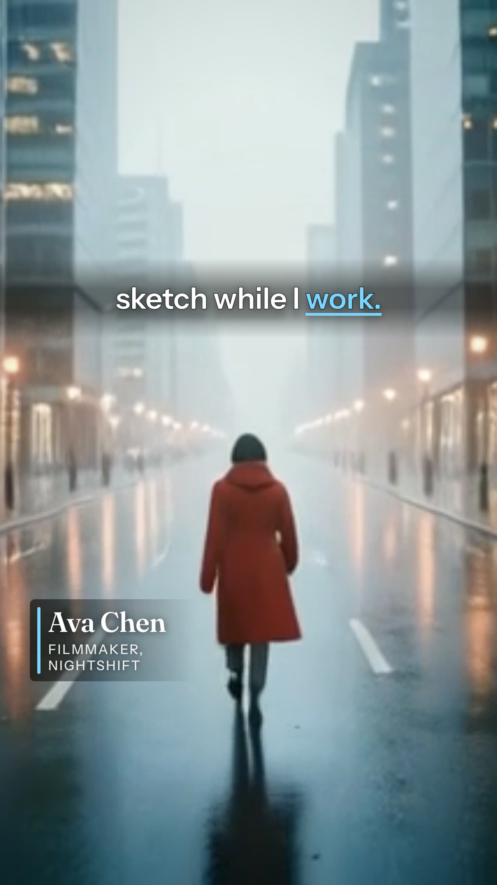

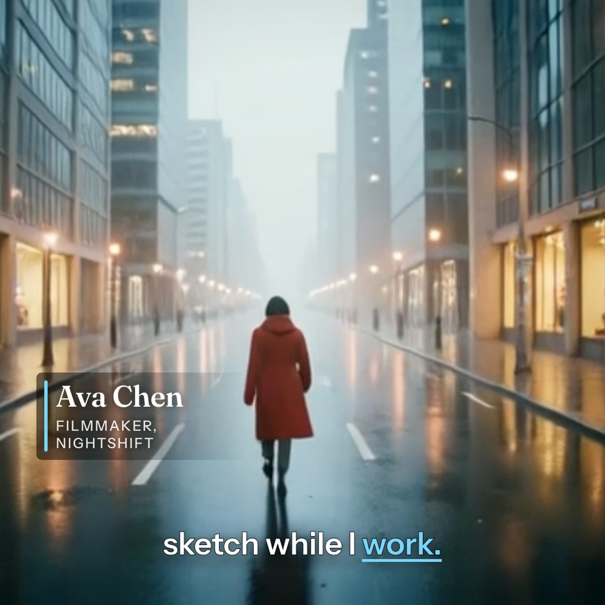

## Style is data

Everything above is a default in `packages/editor/src/style.ts`. A timeline's `style` overrides any of it: palette,
fonts (ten families ship), caption look and position, dissolve length, fades, letterbox ratio, vignette, grain,
beat pulse. The UI can offer a few named styles later without touching the renderer. A product ad can borrow the
cinematic look by setting `look`.

## Checking a change

```sh
pnpm --filter @nightshift/editor samples -- --compose auto   # stills at key moments, no render, about a minute
pnpm --filter @nightshift/editor samples                     # every template in every aspect to MP4
pnpm --filter @nightshift/engine e2e:templates               # the same through the engine's API
pnpm --filter @nightshift/editor exec tsx scripts/focus.ts --aspect 9:16 --draw /tmp/boxes clip.mp4   # the subject box, drawn on a frame
```

The samples find the real footage in the main checkout's `outputs/demo` and the LTX smoke render in
`outputs/smoke/render`; without them, generated shots stand in.

## Known limits

- The subject box comes from colour, not from a detector. A figure in grey on a grey street gets only a modest box
  around the subject point. A wall of bokeh lights (the cafe window) counts as a subject; it is wide, so it never
  pulls a shot's captions off the film's line, but it does take part in the vote for that line.
- A subject that fills the frame (the cup in close-up, the end of the crash zoom) cannot be cleared. Captions and
  cards over it keep their usual place; a scrim or the pill carries the text.
- Line counts are estimated from average character widths per face, not measured in the browser. A caption that
  wraps one line more than estimated still clears the subject by the gap, since the block grows away from it.

## Open questions

1. Captions on 9:16 default to 24% (film) or 32% (ad, intro) up from the bottom, above TikTok's and Reels' own
   captions, and drop to 22% when that clears a subject. Instagram's feed crops 9:16 to 4:5 in the grid; should the
   lines move up a little more for that?
2. The lime accent on the music video and the coral on the ad are opinions. Both read on the real footage; both
   could become per-project choices once the UI offers styles.
3. The end card's panel colour runs under the phone apps' controls, so a desktop viewer sees a block of colour
   below the call to action. It stays plain for now.
