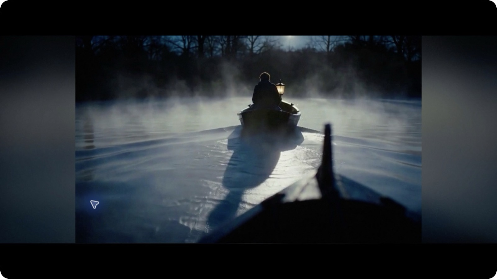
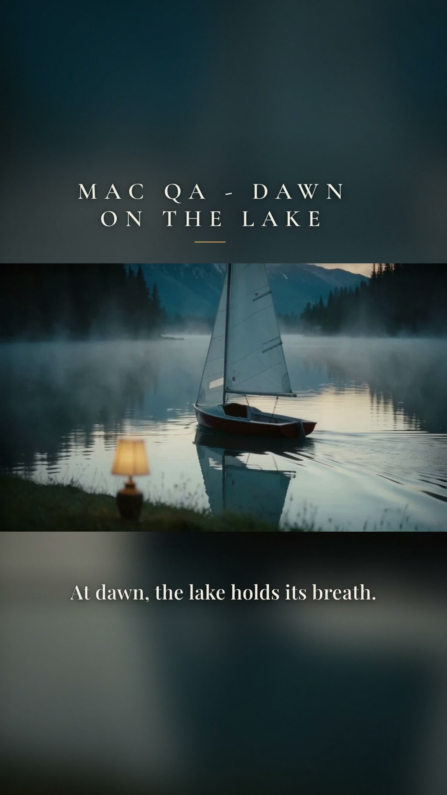
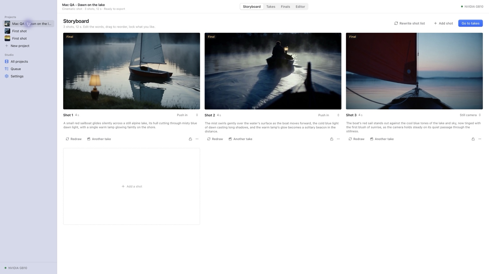
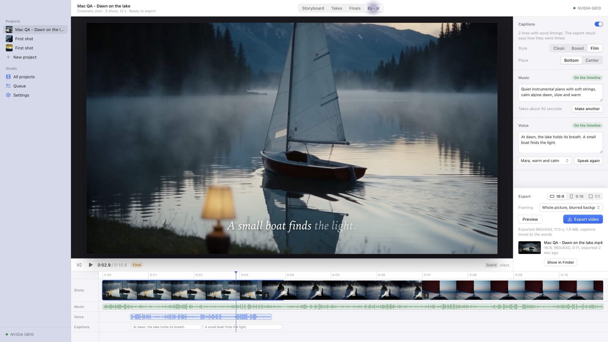
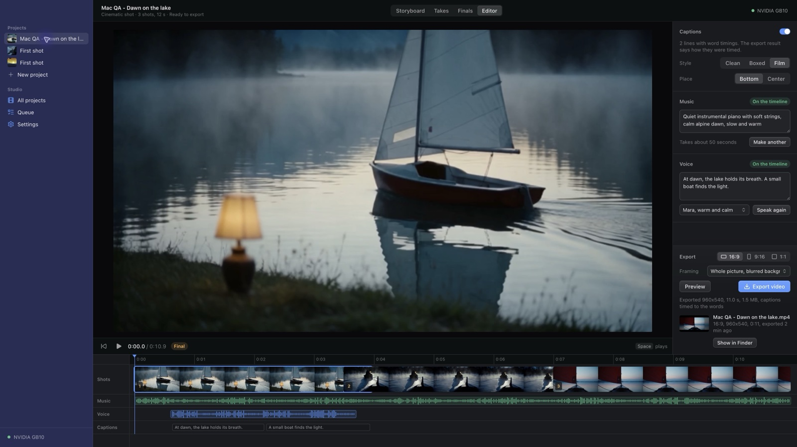

# Nightshift Mac app QA, October 19, 2026

The installed app completed a real three-shot project on the DGX Spark, including same-take finals, a remaster, voice, music, and landscape and portrait exports. Twelve defects were fixed in eleven small commits. The final DMG is installed in `/Applications/Nightshift.app`.

This is a broad functional and visual pass, with specific coverage limits below. It is not a claim that every native menu command was clicked in both themes. Native automation stopped responding during the last extra menu sweep. No known failure remains in the completed project path.

The [October 20 follow-up](#october-20-follow-up) fixes the sidebar tint and near-match export framing, and completes most of the native checks left below. Physical mouse/trackpad reordering is still not certified.

## Builds and environment

- Apple M4 Max Mac, 128 GB shared memory. No real model runs or model downloads on this Mac.
- Read `AGENTS.md`, the plan, hackathon rules, design README, flows, screens, visual system, desktop README, and engine remote-mode README before testing.
- Built from the redesign merge `bd0a7e5`, then rebuilt after the fixes through `79ed57c`.
- Ran `npx pnpm@10.33.0 install`, `build`, `build:desktop`, and `--filter @nightshift/desktop dmg`. Replaced the app by moving the old bundle aside, then copying the mounted DMG's bundle. No overlay install.
- Normal mode used the in-app network path with `gpu-box`, at `http://gpu-box:8190`. The local engine owns the SDK proxy. No Spark service was started, stopped, restarted, installed, or reconfigured.
- Packaged demo used `--mock`, an isolated data directory named `Nightshift Mac QA Demo 2026-10-19`, and accelerated fake jobs. It still used the real packaged engine and editor.
- Additional exhaustive option and failure-state checks used the documented browser mock with Vite. These are marked B below. Browser mock exports are simulated and do not prove MP4 rendering.
- Native windows were checked at the minimum size, a normal window, and full screen. Browser layout was also checked at 920 x 620 in both themes.

## Real project and exports

Project: **Mac QA - Dawn on the lake**, `prj_mvfi1bap41a8b5355d`. The brief asked for a red sailboat on a calm alpine lake at blue dawn. All generation was submitted through the installed app to Spark through the Comfy SDK.

| Step | Result |
| --- | --- |
| Write storyboard | Three shots created |
| Draw stills | Three real stills completed |
| Make drafts and pick takes | Three real motion drafts completed and picked |
| Same-take finals | Shots 1 and 3 completed |
| Remaster | Shot 2 completed; visible drift from the draft is consistent with the UI's explanation |
| Overnight | Queued, cancelled a selected pending job, resubmitted, then used Start now instead |
| Voice | Mara, “At dawn, the lake holds its breath. A small boat finds the light.” completed, with word timings |
| Music | Quiet instrumental piano and strings completed and appeared on the timeline |
| Preview | Real local 960 x 540 MP4 completed; repeated successfully in the final installed build |
| Landscape export | 1920 x 1080, 11 seconds, 12,651,135 bytes, H.264 and AAC at 48 kHz |
| Portrait export | 1080 x 1920, 11 seconds, 18,039,132 bytes, H.264 and AAC at 48 kHz |
| Open exports | Revealed through the app and opened in QuickTime; both played |
| Decode check | Full ffmpeg decode of both standard exports succeeded with no errors |

Export files remain in `~/Library/Application Support/Nightshift/projects/prj_mvfi1bap41a8b5355d/assets/`:

- Landscape: `ast_mvfiinyo84212513bf.mp4`
- Portrait: `ast_mvfijfu978fb3fe4b6.mp4`

[Export metadata](mac/real-exports.json) and [real job results](mac/real-jobs.json) preserve the checks. Intentional cancellations are recorded as cancellations. No real job failed in this project. An additional fresh First shot project was completed while checking onboarding. Existing older projects were not reset or deleted.

## Defects fixed

All fixes are in `apps/web` or `apps/desktop`. No shared contract, engine, or editor package changes were needed.

| Defect and reproduction | Fix and verification | Commit | Evidence |
| --- | --- | --- | --- |
| Check Spark, then edit the address. The old ready result and Use button remained valid for the new address. | Clear the result on edits and ignore stale in-flight check responses. Checked ready, missing, unreachable, and edited-address states. | `3397209` | [Before](mac/before-remote-address.jpg), [after](mac/after-remote-address.jpg) |
| New project and Settings shortcuts had no discoverable native menu entries. | Added File > New project and Nightshift > Settings, with their accelerators. Native menu New project and both shortcuts opened the right screens. | `e7b7cd8` | Native accessibility inspection. A before-menu screenshot was not captured. |
| Space did not reliably play after entering Editor or seeking from timeline controls. | Focus the preview on entry and allow Space from timeline controls. Verified native Play becomes Pause and time advances, plus browser checks after seeking. | `016de98` | [Before](mac/before-space.jpg), [after](mac/after-space.jpg) |
| Setup panels shrank inside a stretched flex column, clipping lower content instead of scrolling. | Align setup body children to the start. Verified the full setup, timing and alternative setup content can scroll into view. | `b34bd63` | [Before](mac/before-setup-clipping.jpg), [after](mac/after-setup-clipping.jpg) |
| Edit a shot prompt, blur into camera selection, then change duration before the first save returns. Earlier values were lost. | Serialize edits and apply each change to the latest saved shot list. Verified all three values and reordered IDs persist. | `a136f8d` | [Before](mac/before-shot-edits.jpg), [after](mac/after-shot-edits.jpg) |
| While attached to Spark, local export work was labeled as running on NVIDIA GB10. Audio timing had the same location problem. | Classify export and audio analysis as local work in toolbar/sidebar, and clarify Queue copy. Native final Preview showed “Export on this Mac” and “This work runs on this Mac.” | `af48b3c` | [Before](mac/before-export-location.jpg), [after observation](mac/after-export-location.txt), [completed Editor](mac/completed-editor.jpg) |
| Quickly change overnight enabled, start and end. Saves overwrote one another. | Queue partial overnight edits and merge with the latest settings. Verified enabled plus 22:00 to 05:00 persisted together. | `ddc874a` | [Before](mac/before-overnight-edits.jpg), [after](mac/after-overnight-edits.jpg) |
| Quickly change caption style, position and framing. Later saves restored older choices. | Queue style changes against the latest project timeline. Verified Boxed, Center and Crop persisted together. | `a91820b` | [Before](mac/before-editor-edits.jpg), [after](mac/after-editor-edits.jpg) |
| Click the already-selected Editor tab, then press Space. Focus on the toolbar swallowed playback. | Allow Editor Space handling from toolbar controls. Verified in the final installed demo and real app, in light and dark. | `9df29ab` | Shares the playback evidence above; native final accessibility showed Pause and an advancing playhead. |
| In packaged demo mode, Check Spark succeeded but Use failed with a low-level fixed-mode error. | Explain the fixed demo connection up front and disable Use. Hardware checks remain available. Verified in the final installed demo. | `d670183` | [Before](mac/before-demo-remote.jpg), [after](mac/after-demo-remote.jpg) |
| At minimum width, the final timeline labels almost touched. | Omit the penultimate tick when its gap from the end label is too small. The measured label gap grew from under 1 px to over 53 px. | `d670183` | [Before](mac/before-ruler.jpg), [after](mac/after-ruler.jpg) |
| Choose a photo with the native picker, Remove, then choose the same file. No change event fired and Create stayed disabled. | Reset the file input after selection and removal. The same native picker sequence now restores the photo and enables Create. Shared upload control also covers songs. | `79ed57c` | [Before](mac/before-same-upload.jpg), [after](mac/after-same-upload.jpg) |

Screenshots are unaltered UI captures, resized to JPEG at exactly 1600 px wide. Some before/after pairs use the browser UI after reproducing the defect natively. The export's after screenshot was captured after completion; the text record preserves the native running-state labels. No missing screenshot was reconstructed.

## Control matrix

N = installed native app. D = installed app with the real engine in mock mode. B = browser mock. “Both” means the control was exercised in light and dark, often with B supplementing the native project path. It does not mean every permutation was repeated natively.

| Screen | Controls checked | Theme / mode | Result |
| --- | --- | --- | --- |
| Welcome | Continue | Light D; N initial setup | Pass |
| Hardware | This Mac; A GPU computer on my network | N, D, B | Pass; no local installation started |
| Hardware | Automatic detection; Not right? Enter it yourself | N, D | Pass |
| Manual hardware | Graphics, system, model name, shared-memory toggle, graphics/system memory, free disk, Use these numbers | D, B | Pass for tested Apple and NVIDIA profiles |
| Manual hardware | Cancel; Back; Continue | D, B | Pass |
| Detection error | Manual fallback; Try again | Light B | Pass; recovery state not repeated in dark |
| Setup | Memory slider; Other setups disclosure and alternatives | D, Light B | Pass; disabled alternatives remain disabled |
| Setup | Back; Try the demo setup | D, B | Pass |
| Demo install | Progress; connection failure; Try again | Light B | Pass; retained progress and continued |
| First shot | Automatic still/draft; failure; Try again | D; Light B failure fixture | Pass |
| First shot | Open this shot; Start creating | D, B | Pass |
| First shot | Skip ahead | Available in the failure fixture | Not separately exercised |
| GPU setup | Address input; Check; Use NVIDIA GB10 | N real; both B | Pass |
| GPU setup | Check again; missing models; unreachable host | Both B | Pass; no real outage induced |
| GPU setup | Edit checked address; invalid address; Back/Cancel; Escape | Both B; N reproduction | Pass after fix |
| Demo GPU sheet | Explanation; disabled Use; Cancel | Final D | Pass |
| Sidebar | Each project link; New project; All projects | N, D, both B | Pass for test projects |
| Sidebar | Queue; Settings; compute/activity footer | N, D, both B | Pass |
| Toolbar | Storyboard; Takes; Finals; Editor | N, D, both B | Pass |
| Toolbar | GPU/settings link; active job/queued overnight links | N, both B | Pass |
| Library | Project cards; all New project entry points | N, D, both B | Pass |
| Morning summary | See the finals | N | Pass |
| Morning summary | Got it | Both B, completed-overnight fixture | Pass; banner dismissed |
| New project | All four template selectors | Both B, native spot checks | Pass |
| Cinematic shot | Brief; photo choose/remove; nine camera options; six looks | Both B; native file picker | Pass |
| Cinematic shot | One/three shots; Wide/Tall/Square; name; Create storyboard | Both B; real three-shot N | Pass |
| Music video | Write/upload song; song fields; genre tiles; 30/60 seconds; formats; name; Create | Both B | Pass; all six genre options exercised |
| Product ad | Photo choose/remove; product fields; four tones; four voices; formats; name; Create | Both B | Pass |
| Talking intro | Script; four voices; three visual options; formats; name; Create | Both B | Pass |
| File picker | Cancel; select photo; Remove; select identical path again | N/D light | Pass after fix; identical audio path was not separately repeated natively |
| Storyboard | Prompt; duration; all nine camera selections | Both B; N real edits | Pass after save-race fix |
| Storyboard | Draw/Redraw; single draft/Another take; Make drafts; Go to takes | N, D, both B | Pass |
| Storyboard | Lock; Unlock | Both B; native spot check | Pass; locked controls disable |
| Storyboard | Add shot button; Add a shot tile | Both B | Pass |
| Shot menu | More; Delete; Escape; menu End key | Both B | Pass |
| Rewrite dialog | Open; Cancel; Escape; confirm Rewrite shot list | Both B | Pass; replacement storyboard completed |
| Storyboard reorder | Pointer drag; keyboard Space/arrows/Space; Escape | B pointer, D keyboard | Persisted order; native pointer remains a coverage limit |
| Still failure | OOM message; retry | Both B | Pass |
| Takes | Every shot rail item; Make a draft; make all drafts | N, D, both B | Pass |
| Takes | Another take; take playback/select; Compare; Pick/Picked | N, D, both B | Pass |
| Takes | Next shot; Finish | Both B; N/D Finish | Pass; Next shot opened unpicked shot 2 |
| Draft failure | Try again; Memory settings | Dark B | Pass; Light draft-specific failure was not repeated |
| Finals | Same take; Remaster; unavailable Remaster explanation | N, both B; D Apple setup | Pass |
| Finals | Select all; select each shot; disabled pending controls | Both B; N real | Pass |
| Finals | Finish now; Finish overnight | N, D, both B | Pass |
| Overnight sheet | Not now; Escape; Queue for tonight | N/D, both B | Pass |
| Finals queue | Per-shot Cancel; Start now instead | N, D, both B | Pass |
| Final failure | Try again; Tonight | Both B | Pass |
| Finished finals | Open the editor | N, both B | Pass |
| Queue | Pending/running/done/failed/cancelled rows; project links | N, D, both B | Pass for exercised states |
| Queue | Remove; Cancel; retry/overnight actions | N/D and B | Pass; every action was not separately repeated natively in both themes |
| Editor | Play; Pause; Back to start; Space on entry | N, D, both B | Pass after focus fix |
| Editor | Space after selected Editor tab click | Final N/D, both | Pass after fix |
| Editor | Playhead slider; Home/End/arrows; Space after seeking | Both B; native seeking | Pass |
| Editor | All shot, music, voice and caption track targets | Both B | Pass |
| Captions | Show captions off/on; Clean/Boxed/Film; Bottom/Center | Both B; N real | Pass after save-race fix |
| Voice | Script; all four voices; Make voice; Speak again | Both B; N real Mara generation | Pass |
| Music | Prompt; Make music; Make another | Both B; N real generation | Pass |
| Cut ownership | Edited by hand state; Re-cut | Both B, explicit edited-timeline fixture | Pass |
| Export | 16:9; 9:16; 1:1; both framing options | Both B; N real wide/tall | Pass |
| Export | Preview; Export video; progress; result; Open file/Show in Finder | N, both B | Pass; real wide/tall files decoded and played |
| Compute settings | Change; Cancel; Use this Mac; reconnect Spark | N; both B | Pass; Mac setup was entered without installing |
| Compute settings | Check again after GPU-away fixture | Both B | Pass; Spark itself was kept running |
| Appearance | System; Light; Dark | N/D, both B | Pass; native material and UI follow the choice |
| macOS Appearance | Actual OS Light then Dark while app uses System | N | Pass; original Dark setting restored |
| Memory settings | Slider; persisted limit | D, B | Pass |
| Overnight settings | Enable; start/end fields | N/D, B | Pass after queued-save fix; native time-picker popover not separately exercised |
| Keyboard | Cmd+N; Cmd+Comma; Cmd+1/2/3/4; Space; Escape | N/D and both B | Pass on tested screens |
| Native menus | About; File > New project; Settings shortcut; Desktop status; Finder reveals | N/D | Pass; not every item repeated in both themes |
| Window lifecycle | Close; reopen; full screen; return to window; minimum size | N/D | Pass for exercised paths |
| Overnight native shell | Keep awake while queued; release after completion; Keep rendering; Stop and quit | D | Pass; three queued finals survived quit/relaunch and completed |
| Right click | App-specific context menus | Source inspection and UI | No app-specific right-click handler is offered; More menus were tested |

[Control run notes](mac/control-runs.json) supplement this table.

## Final visual and package verification

The final pass checked the porcelain light and metallic dark surfaces, sidebar material, toolbar segments, preview, timeline, inspector, sheets, focus rings, scrolling and minimum-size layout. No remaining visible clipping or horizontal page overflow was found on the checked screens. Native screenshots sometimes lagged the accessibility state or failed while sheets were open; full-screen captures were used where needed.

| Check | Final result |
| --- | --- |
| Repository typecheck | Passed for all packages |
| Repository tests | 328 passed: 230 engine, 90 editor, 8 desktop |
| Production build | Passed |
| Desktop build and DMG | Passed after the final code fix |
| Installed codesign verification | `--verify --deep --strict` passed, local ad-hoc signature |
| Installed runtime verifier | Passed under Electron's embedded Node: SQLite, UI, seven recipes, fonts, editor, render browser, ffmpeg, ffprobe and uv with bare PATH |
| Diff whitespace check | Passed |
| Shared contract changes | None |

The build still prints Rollup's Zod annotation and large-chunk warnings. They did not fail the build. No lint command is defined in this repository. Engine/editor code did not change; their complete existing test suites were rerun. The UI fixes were verified through their reproduced interaction sequences rather than tests that mirror implementation.

## What remains and cleanup

- The full “every control twice in the installed app” bar is not certified. Standard Edit, View and Window menu commands, Open app data in Finder, the native time-picker popover, Skip ahead, and every theme permutation of native dialogs were not fully exercised. The final extra menu sweep was blocked by `Sky Computer Use request timed out`, then `Sky Computer Use native pipe closed before response`. Resetting the native automation session did not recover it.
- Native pointer drag automation did not complete a reorder. The installed app's keyboard reorder passed, and a paced browser pointer drag exercised the same sortable UI and persisted its order. A human native mouse/trackpad drag remains worth checking.
- Detection/install/first-shot failure recovery was tested in Light browser fixtures. Still/final errors were checked in both themes; a separate Light draft OOM and disk-full install recovery were not run. No real Spark outage, real disk-full condition, or overnight wall-clock wait was induced.
- No distribution/notarization or other-Mac Gatekeeper test was performed. No account signing was used.
- Before screenshots are missing for the native-menu discoverability defect. Playback issues share one pair. Running local-export labels have native accessibility evidence instead of a successful after screenshot. All available screenshots are in `docs/qa/mac/`.
- Nightshift was closed normally after the final real pass. A later attempted menu sweep relaunched it, but native automation could not attach; after verifying zero active jobs, the exact Nightshift main PID was sent TERM. Its local engine and proxy were then checked for shutdown. Vite and both QA preview tabs were stopped/closed. No unrelated service was stopped.
- App Appearance was restored to System, macOS to its original Dark appearance, and normal app compute to Spark. Test projects and exports remain available. Old application bundles were moved aside under `/tmp`, not deleted.
- Final Spark status: our runtime (`ohf-comfyui`) running, **56 GB**, **preemptible**, PID **2740419**, unchanged throughout this pass. No large download or cloud GPU was used.

[Final state record](mac/final-state.json).

## October 20 follow-up

Two fixes were made and tested in the installed app, using its real engine in demo mode. No Spark jobs, model downloads, account signing or public actions were used. Normal app data and the real Spark project were not edited.

### Visual fixes

- Sidebar, `8795151`: a 96% neutral porcelain or metallic-black tint now covers the native sidebar material. The remaining 4% keeps a hint of depth. Tested both themes with macOS's solid Blue Violet wallpaper and wallpaper tinting enabled. A blank sidebar sample changed from RGB 46/46/54 to 22/23/27 in dark mode, and from 226/225/230 to 243/243/245 in light mode. Original wallpaper was Tahoe, Automatic, on all Spaces; it was restored after testing.
- Framing, `e7cc990`: the UI checks the dimensions of the actual timeline assets, falling back to the project's aspect when dimensions are unavailable. It offers Whole picture only when at least one shot differs from the export by more than 10%. Near matches say Crop to fill and explain the small crop. The renderer makes the same per-clip comparison against the export shape, before decorative cinematic letterboxing. The saved framing value is preserved.
- The installed baseline and fixed build each exported the same three-shot demo at 960x540. The sources were 1280x768 finals, with `picture.reframe: "fit_blur"` saved. The baseline showed blurred sides inside the cinematic bars. The fixed export filled the picture area. Both MP4s decoded without errors. Switching the fixed UI to 9:16 restored the Whole picture control with its saved selection.
- Two editor regression tests cover a near-match final with cinematic bars and mixed source shapes in a portrait export. They check that near matches crop, different shapes retain blur, and the stored preference is unchanged.

Evidence:

- Dark sidebar: [before](mac/2026-10-20-before-dark.jpg), [after](mac/2026-10-20-after-dark.jpg).
- Light sidebar: [before](mac/2026-10-20-before-light.jpg), [after](mac/2026-10-20-after-light.jpg).
- Framing control: [before](mac/2026-10-20-before-framing.jpg), [wide after](mac/2026-10-20-after-framing.jpg), [portrait after](mac/2026-10-20-after-portrait-framing.jpg).
- Actual exported frame at two seconds: [before](mac/2026-10-20-before-export.png), [after](mac/2026-10-20-after-export.png). These are unmodified 960x540 decoded frames. UI captures are resized to 1600 px wide, without changing their contents.

### Native checks

- Edit: Cut, Copy, Paste, Paste and Match Style, Select All, Delete, Undo and Redo worked on the Editor's Music prompt. Cut cleared the selected text, Undo restored it, Redo removed it, and copying/pasting doubled the exact text. Test text was cleared. This pass did not invoke system Writing Tools, Dictation, or account services.
- View: Reload returned to the same project and retained the saved framing. Zoom In, Zoom Out and Actual Size worked. Toggle Full Screen entered and left full screen.
- Window: Minimize and Cmd+0 restored the window. Zoom, Bring All to Front, Center and Top Left tiling worked. Native tiling reached 920x621 points on the storyboard, including the window border. The Editor was also checked at 960x621 in both themes. The inspector and export region scrolled, the timeline remained usable, and no page clipping was found. [Storyboard](mac/2026-10-20-window-quarter.jpg), [light Editor](mac/2026-10-20-minimum-editor-light.jpg), [dark Editor](mac/2026-10-20-minimum-editor-dark.jpg).
- Open app data in Finder opened `~/Library/Application Support/Nightshift Mac QA Demo 2026-10-19`. The Finder window contained the expected settings, SQLite, projects and runtime folders. The test Finder window was closed afterwards.
- The native Settings time popover opened in both themes. Its hour list changed the start time from 23:00 to 22:00, and the summary updated. The original 23:00 to 07:00 settings were restored and verified. [Light popover](mac/2026-10-20-time-popover-light.jpg), [dark popover](mac/2026-10-20-time-popover-dark.jpg).
- Skip ahead passed in a fresh isolated demo folder, `Nightshift Mac QA Skip 2026-10-20`. `NIGHTSHIFT_MOCK_SPEED=5` slowed simulated work enough to exercise it while the sample was rendering. The button opened the library and the sample project remained visible with its active job. [Before](mac/2026-10-20-skip-before.jpg), [after](mac/2026-10-20-skip-after.jpg). The app was then quit normally; the test project remains in that isolated folder.
- Native dialogs: About, Desktop status, the photo picker and the Open a project first informational alert opened and dismissed in both themes. The photo pickers were cancelled without creating a project. [Light status](mac/2026-10-20-status-light.jpg), [dark status](mac/2026-10-20-status-dark.jpg), [light alert](mac/2026-10-20-finder-alert-light.jpg), [dark alert](mac/2026-10-20-finder-alert-dark.jpg). About screenshots hit ScreenCaptureKit error `-3811`; its native accessibility content and close action were checked instead. Crash/restart dialogs and every system-added submenu were not induced.
- Native pointer reorder remains unverified. Repeated `cua_repl` mouse drags over the storyboard's video frames reported Picked up shot 1, but never reported a completed drop or changed the persisted shot IDs. Resetting the native session and retrying did not resolve it. A temporary native-media drag guard was tested, did not fix this result, and was removed. No unproven drag fix is shipped. [Before](mac/2026-10-20-before-drag.jpg), [failed attempt](mac/2026-10-20-after-drag.jpg). This is a coverage limit, not a passed check or proof that a physical mouse drag fails. A human mouse/trackpad check is still needed.

### Package and cleanup

- Repository typecheck passed. All 330 tests passed: 230 engine, 92 editor, 8 desktop. The first isolated editor run lacked the contract build in this fresh worktree; after building workspace dependencies, the complete suite passed.
- Production build and desktop DMG build passed. Existing Rollup dependency-annotation and bundle-size warnings remain non-fatal. No lint command is defined.
- The final DMG is `apps/desktop/release/Nightshift-0.1.0-arm64.dmg`. Each replacement moved the previous app aside before copying the mounted DMG bundle. The final installed bundle passed deep strict ad-hoc signature verification and the packaged runtime verifier.
- The normal app's saved appearance and compute settings were not changed. Demo appearance was returned to System and its overnight times to 23:00 to 07:00. macOS remained Dark. Tahoe Automatic wallpaper was restored. No unrelated service was stopped.
- The final installed app was launched in demo mode, verified, and closed. Its engine and renderer processes stopped. No active jobs remained in the main demo folder. Old bundles remain under `/tmp`. The physical drag check above is the only requested native interaction not completed.
- Shared contract changes: none. Code changes are confined to `apps/web` and the editor's framing application and tests.

[Follow-up state record](mac/2026-10-20-final-state.json).
