# Camera moves, 21 October 2026

Implemented ten presets and ran all ten through the real app on the Spark. Seven produced usable shots on the tested sources. The lake same-take final and clean export passed; glass, hands and newly exposed surfaces remain weak.

## Pipeline

A photo goes through MoGe-2 on the Spark. The engine reads its inverse-depth image and the identically resized source photo, reconstructs a bounded point cloud, and renders an explicit camera path on the CPU. The median depth in the central 20% of the image is three scene units. This focuses the orbit and dolly zoom on a centred subject. The lens is fixed at 0.9 times the longer image dimension. This is a relative-depth reconstruction, not a calibrated or complete scan of the scene.

The layout starts at the source camera. Every pixel therefore starts at its original image coordinate. A depth buffer resolves visible surfaces during the move. Small point splats close sampling gaps; newly revealed space remains grey. Nothing invents hidden geometry.

The video workflow loads LTX 2.5 distilled with the Layout-To-Render IC-LoRA. Core `LoraLoaderModelOnly`, `GetICLoRAParameters` and `LTXVAddGuide` provide the control. The source photo is also pinned into the first frame. The graph generates audio, crops the guide frames, and saves the joint audio-video latent for the ordinary same-take final.

All inference uses the Comfy SDK and comfy-api-proxy. The CPU renderer uses ffmpeg to read image pixels and encode the grey layout. It needs no Python environment or model on the user's Mac. No new ComfyUI node pack is needed.

## Early checks

- Core MoGe nodes were available; the MoGe-2 weights were not. Added the 662 MB model to Nightshift's model directory. No shared model was changed.
- A native mesh projection ran through the SDK. `SaveGLB` produced a file, but the proxy exposed no downloadable output for that node. The shipped path uses `SaveImage` depth and source outputs instead.
- An early L2R attempt uploaded a layout before its encoder finished. The video loader rejected that incomplete MP4. Subsequent runs wait for ffmpeg's successful exit.
- The completed cabin dolly rendered 97 frames at 640x384, 24 fps, with audio and a saved joint latent. SDK wall time was 107.9 s, including any queue wait.
- The completed workshop orbit used the same graph. SDK wall time was 136.0 s, including queue wait.

The source images come from earlier Nightshift projects: generated photoreal stills of an aurora lake, a workshop, an amber perfume bottle, and a ferry cabin, plus the earlier uploaded mug reference. None is a measured 3D scene.

## First review

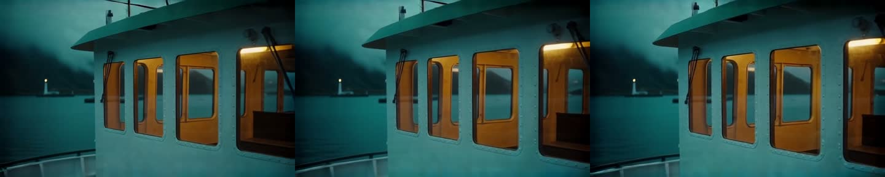

The cabin grows with the forward move. Its framing and lighting hold. Window edges soften and shift a little. This is usable as a short atmospheric shot, but it does not keep every rigid edge exact.

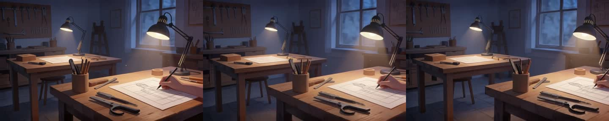

The viewpoint arcs left. The foreground desk shifts against the back wall. The hand and lamp change shape slightly. A source without a hand is a better demo candidate.

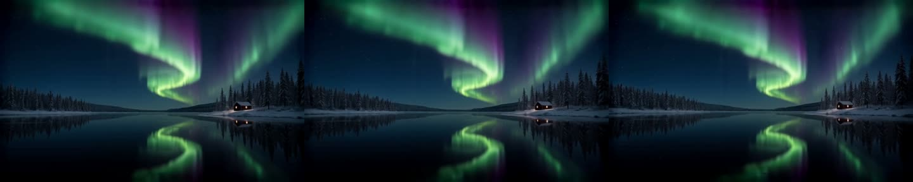

The lake pullback preserves the cabin and shore. The aurora changes shape and brightness, and the pullback is subtle. It is an atmospheric result rather than a rigid reconstruction of the sky.

## Preset distances

Paths ease in and out, except the crash zoom. Translation distances below use the reconstructed scene's units, with the central subject depth at 3.

| Preset | Path |
|---|---|
| Dolly in | Forward 0.35 |
| Push in | Forward 0.5 |
| Pull back | Back 0.35 |
| Orbit left / right | Arc 5.16 degrees around the centre at depth 3 |
| Crane up / down | Vertical 0.25, aimed at the centre |
| Crash zoom | Lens 1x to 1.65x between 20% and 50% of the shot |
| Dolly zoom | Back 0.5 with lens compensation at depth 3 |
| Handheld drift | Small sideways and vertical sine paths, forward 0.12 |

FPV fly-through is omitted. A single visible surface does not provide the room or hidden sides needed for a useful fly-through. The shipped paths keep disocclusion modest. Deep mirrors, glass, fine branches and thin objects remain difficult.

## App verification

The browser can create a camera project by uploading a photo and selecting a visual preset. It goes directly to Takes. Photo & move replaces the storyboard for this template. The first draft uses the uploaded photo directly, without an LLM shot list or image generation.

The app uses a large single-shot take view. Both light and dark appearances were checked in the browser. A draft resumed after restarting only the local engine, without submitting its remote Comfy job twice. The same-take final and export checks below also passed.

## Product failure and correction

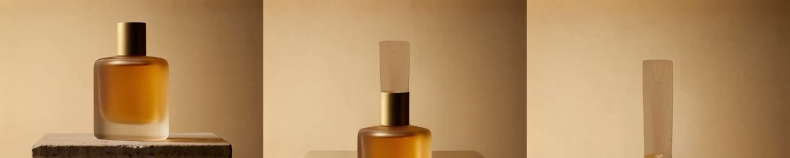

The first app-created product crane failed: the bottle became a tall cap-like shape and left the frame. Its layout remained rigid and in frame.

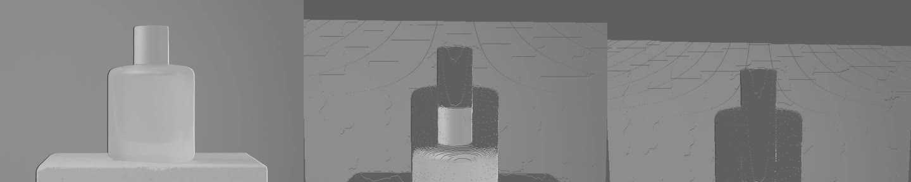

The graph pinned the photo into frame zero but omitted the separate appearance-reference guide used by the upstream L2R workflow. Added an appearance guide at frame zero, at full strength, while keeping the photo pinned there too. Core LTXVAddGuide counts negative indices from the end, unlike the upstream custom node; using -1 would force a return to the source picture at the end. This removes the forced return to the opening picture. It does not solve missing geometry: a later glass orbit still creates a second bottle, and a corrected crane still changes the cap. The failed product takes are not demo candidates.

### Union depth fallback

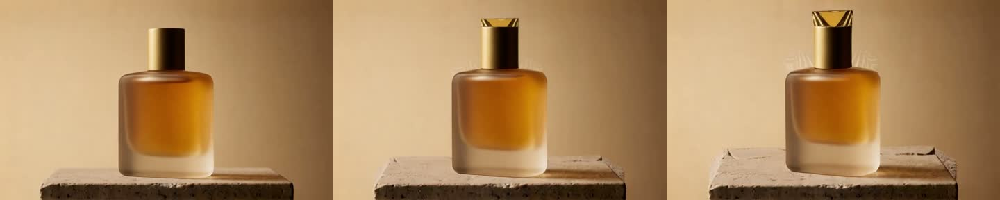

Tried the available `ltx-2.3-22b-ic-lora-union-control-ref0.5` on LTX 2.5, with the point cloud rendered as inverse depth. The body is cleaner than the clay-guided version, but the cap still develops an invented open top. This does not justify another shipped model yet. Transparent glass and newly revealed surfaces remain a poor fit for this reconstruction.

## App pullback

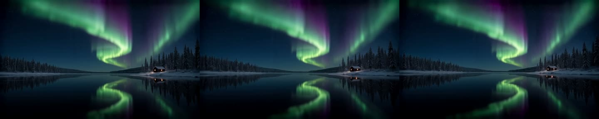

The corrected pipeline keeps the cabin and shoreline during the pullback. The aurora's glow and reflection change, which is acceptable for this scene. This take passed the same-take final and export checks below.

## Reviewed app presets

All of these were created through the project API used by the real app, with the first project created using the browser upload and move picker. Every take has 97 frames at 24 fps.

| Source and preset | Review |
|---|---|
| Ferry, dolly in | Clear forward move. Window frames and warm light hold, with mild edge drift. Good atmospheric demo. |
| Lake, dolly in | Clear forward move. Some tree and reflection warp at the lower edge. |
| Lake, pull back | Cabin and shore hold. Subtle but usable; the aurora changes. |
| Lake, handheld drift | Gentle drift and forward motion. Cabin and shore hold; sky evolves. Usable. |
| Bottle, push in | Clear forward push, bottle stays in frame. Slight shoulder and base drift. Usable. |
| Bottle, crash zoom | Clear optical zoom. Bottle holds. The 1.65x final crop cuts the cap. |
| Workshop, orbit left | Clear desk/wall parallax. Room holds; minor hand drift. Usable. |
| Workshop, crane down | Clear lowering move. Room holds; hand and desk edge drift. Usable with caveats. |
| Workshop, dolly zoom | Background shift is subtle. Hand and forearm deform. Not a hero demo. |
| Bottle, orbit right | Rejected. A second bottle appears where the path exposes missing geometry. |
| Solid mug, crane up | Camera rises; silhouette and handle hold. Liquid/rim folds and lettering drifts. Not a product demo. |
| Bottle, crane up, early graph | Rejected. Shape failure before the appearance guide correction. |

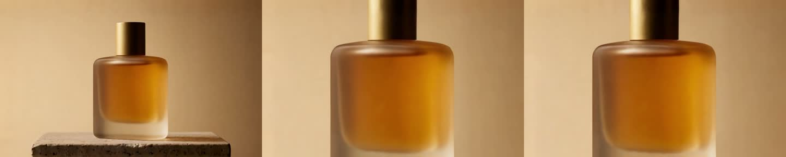

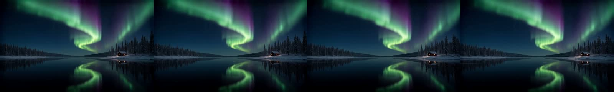

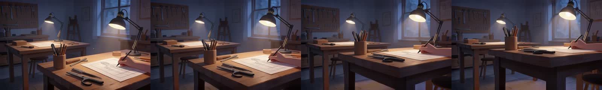

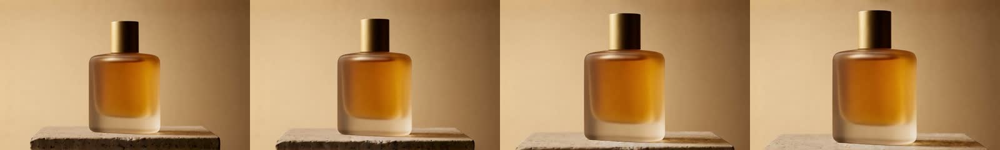

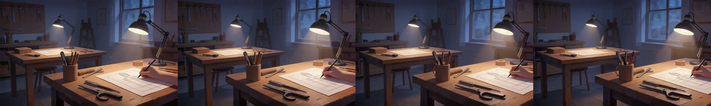

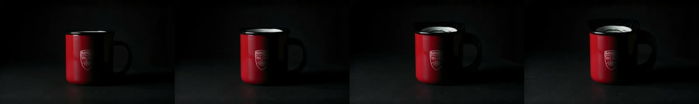

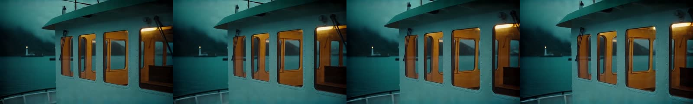

The final app matrix completed all ten presets across twelve drafts. Seven presets produced usable shots on these sources: dolly in, push in, pull back, orbit left, crane down, crash zoom and handheld drift. The stronger dolly zoom effect needs a better source without a hand; the glass orbit and the mug's revealed top are not good product-demo results. The failed early crane and original lake dolly preceded the appearance-guide correction. The other reviewed app shots use the corrected graph.

The paths are exact in the rendered layout. The generative final is guided by that layout and is not a pixel-exact 3D renderer. The smaller paths are deliberate. Larger lateral moves expose missing geometry and give LTX more room to invent objects.

## Measured Spark recipe

At 640x384, 97 frames and 24 fps, the first ten completed app runs measured a median 61.4 seconds of LTX execution, excluding queue wait. The largest sampled GPU process footprint was 40.76 GB. The recipe rounds it to 40.8 GB.

MoGe execution took about 0.67 seconds with its model warm. The largest sampled depth-step footprint was 2.42 GB, rounded to 2.5 GB. Depth download, local CPU projection, layout encoding and upload preparation brought the median layout stage to 8.8 seconds. That stage ranged from 3.7 to 20.7 seconds while tests and other work also ran on the Mac. These are warm shared-process measurements, not a cold-start guarantee.

The recipe records those measured values. Other tiers omit both steps, so the UI hides this template there. The [measurement records](media/camera-moves/measurements.json) include execution timestamps and the samples available for each run. GPU memory came from `nvidia-smi`, because ComfyUI's PyTorch allocator figure misses much of the GB10 footprint. Subsecond depth passes needed a 10 Hz sampling window.

## Same-take final and export

The lake pullback's saved joint latent produced a 1280x768 final with the same 97 frames and camera motion as its 640x384 draft. After downscaling, whole-frame SSIM was 0.957862. The decoded audio was bit-identical. The final records the original draft as its parent and the editor chose it automatically.

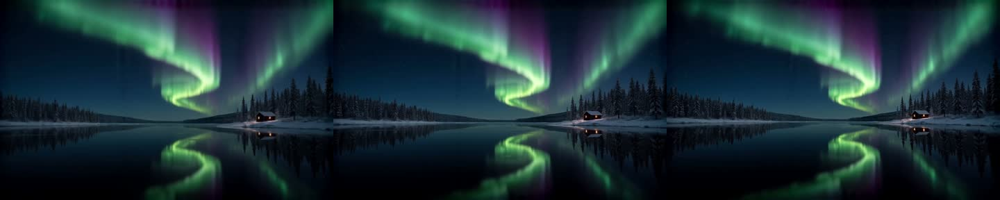

The first real export exposed an existing quick-shot fallback: it added a cinematic title and a black fade. Fixed the camera planner to omit the automatic title and its defaults to omit fades, grain and vignette. Added regression tests and reran the real export. It then made a 960x540, 4.00-second MP4 with audio. The output uses the expected 16:9 crop and contains no added title or placeholder shot. The final and export were inspected, including the app's final status and editor timeline.

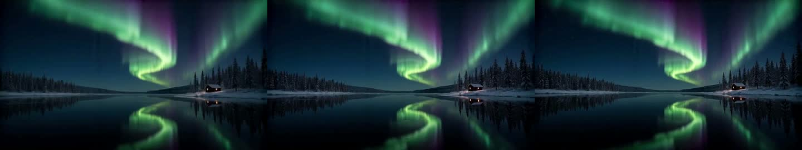

## Contract and checks

The camera work adds no HTTP route or schema. `quickMoves` gained `push_in`, `pull_back`, `orbit_right`, `crane_down`, `crash_zoom`, `dolly_zoom` and `handheld_drift`; the existing `dolly_in`, `orbit_left` and `crane_up` IDs stay unchanged. The camera tagline and outcome copy describe a guided camera path rather than promising exact final pixels.

After merging the References work from main, the final root typecheck and all 352 tests passed: 250 engine, 94 editor and 8 desktop. This includes eight camera path tests, both camera HTTP integration tests, reference compatibility checks, and the clean-export regressions. Recipe validation passed all seven recipes and 42 workflow references. The root production build passed, with the existing Vite chunk-size warning.

The previous timing-based "draft during audio analysis" test hit its timeout during the first root run. Replaced its long audio race with an explicit analysis gate; it still runs real analysis after the draft lands. The next full root run passed.

The References work from main is also merged. Its named image inputs, reference-aware stills and project controls remain intact beside the camera path. See [the reference report](2026-10-21_references.md) for its contract additions. The post-merge build, typecheck and validation of 42 workflow references passed.

## Demo picks

These local files are kept outside git. All three came through the real app pipeline.

| Shot | File | Notes |
|---|---|---|
| Lake pullback, same-take final | `outputs/camera-demo/lake-pullback-final.mp4` | Best finished landscape shot. Aurora evolves; cabin and shore hold. |
| Bottle crash zoom | `outputs/camera-demo/bottle-crash-zoom.mp4` | Clear optical move. Ends in a deliberate tight crop. |
| Ferry dolly | `outputs/camera-demo/ferry-dolly.mp4` | Clear forward move and atmospheric light. Slight window-edge drift. |

The exported lake is `outputs/camera-demo/lake-pullback-export.mp4`. The original draft is `outputs/camera-demo/lake-pullback-draft.mp4`. Full projects, sources, layouts and saved latents remain in `outputs/camera-app/projects/`. The real-render review and frame/audio comparison records are in `outputs/camera-spike/`.

## Round 2: bolder moves

Round 1 was too cautious. The ferry's tracked window section grew only 1.12x; the lake cabin shrank to 0.86x. The bottle's 1.65x optical zoom cut its cap. Those are visible in the old takes, not just in the path constants.

The forward paths now travel 1.35 and 1.65 scene units. At the nominal depth of 3, that means 1.82x and 2.22x magnification. The push reaches its destination at three quarters of the shot and settles. The pullback travels 2.4 units. The optical zoom reaches 2.8x in about half a second, after a short opening hold. Every path still starts at the source camera and uses easing.

The model prompt now names the move as well as describing it. The dolly zoom explicitly asks for a large backward camera move, a compensating lens zoom, and a growing background. The source photo, appearance guide, 97-frame draft and saved-latent final pipeline are unchanged.

### Subject targeting

An absolute near-depth centroid can choose the table in front of a product. The target now favors depth that stands forward of its horizontal neighbours, weighted toward the image centre. This separates a vase from a sloping table without another model. It falls back to a central near-depth region when there is no distinct object, and to the image centre for a distant landscape.

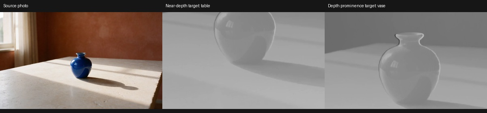

An off-axis lens shift brings this target to the middle of the final crop. It does not rotate the photo or jump on frame zero. A close-up still needs room around the object: a 2.8x zoom cannot keep a bottle that already fills most of the source frame completely visible. The form now says this.

### Measured review

The scale tool is `scripts/measure_camera_move.py`. It matches features from an explicit subject rectangle in frame zero to the middle and last frames. It also follows corners through every intervening frame with a forward/backward optical-flow check, which preserves measurements through large zooms. Both use a RANSAC similarity fit. The tool refuses fits with fewer than eight inliers, tiny clusters or collapsed target points. A synthetic 1.6x clip measured 1.6000x by feature matching and 1.5988x by optical flow. This is an image measurement, not a calibrated camera measurement; it cannot certify shape or identity.

The lake cabin gets too small for reliable feature matching. Its roof span was measured by hand instead: 41 pixels at the start, 21 at the end, about 0.51x with roughly two pixels of uncertainty at each edge. The flow estimate for the same cabin is 0.48x, consistent with that small manual span. A motion fit cannot establish object identity: a floating bowl can still be tracked. Visual failures stay rejected even if a numerical fit survives.

The shipped set has six presets. Scale is the apparent last-frame size divided by the opening size, on the named subject.

| Preset | Round 1 path -> shipped path | Measured result |
|---|---|---|
| Dolly in | Forward 0.35 -> 1.35 | Ferry window section 1.73x. Smooth move; mild edge drift. |
| Push in | Forward 0.5 -> 1.65, arrival at 75% | Studio shelf section 3.28x. Faster and closer than the dolly, with a settled ending. |
| Pull back | Back 0.35 -> 2.4 | Lake cabin about 0.5x. More shore and water in view. |
| Crash zoom | Lens 1.65x -> 2.8x | Cobalt vase 2.87x. The neck and base stay in frame. |
| Dolly zoom | Back 0.5 -> 4.5, full lens compensation | Bowl 0.91x; shelves 1.86x. The depth change is unmistakable. |
| Crane up | Rise 0.25 -> 0.75 with tilt | Harbor ferry 0.97x. Clear rise and roughly 14 degrees of tilt. |

The ferry and lake before/after pairs use the same source photo. Other pairs use new sources to avoid glass, hands or blocked views. The [review data](media/camera-moves/round2/review.json) records all 17 drafts, the baseline measurements, source hashes, seeds, prompts and final verification.

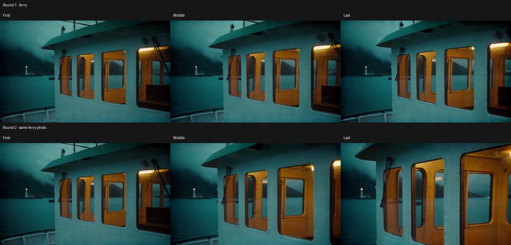

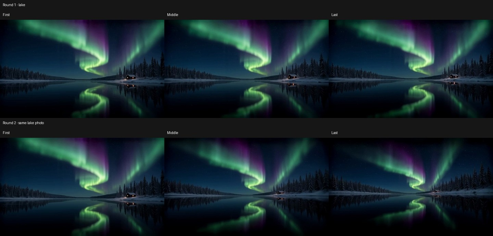

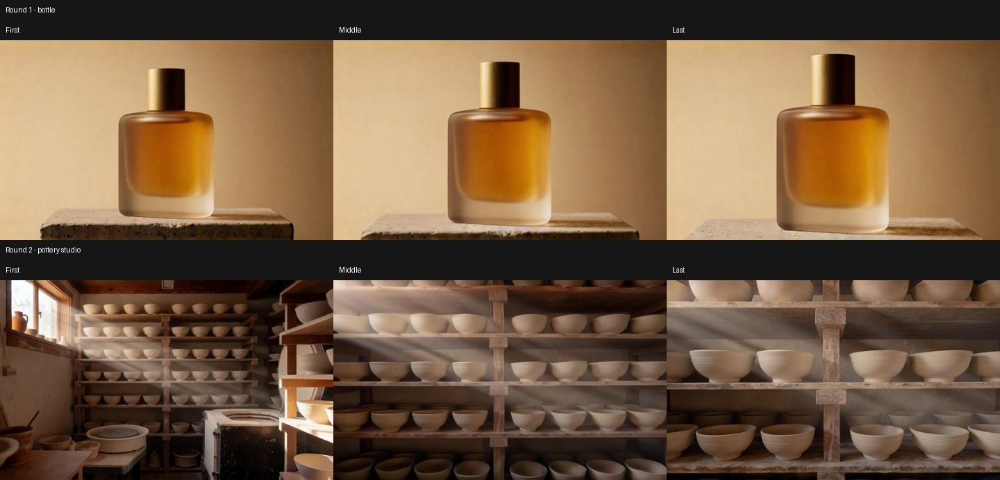

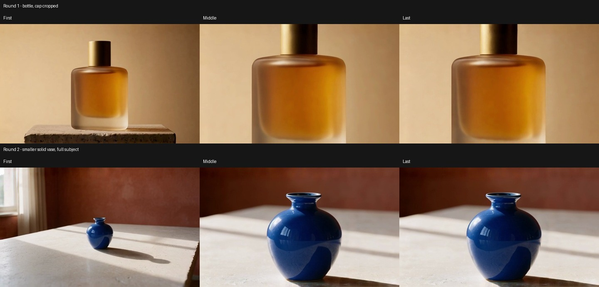

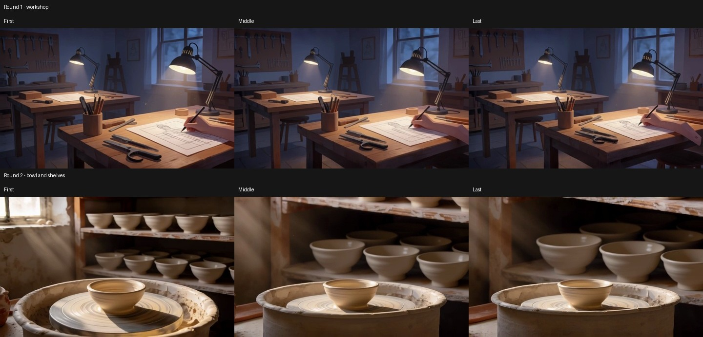

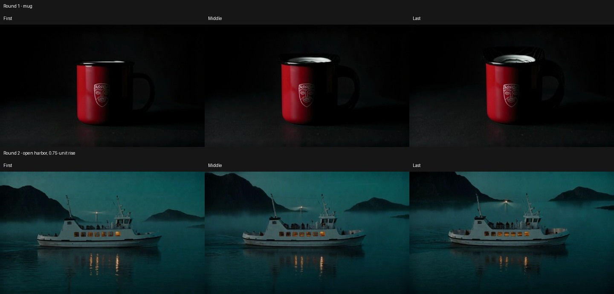

### Limits found by pushing harder

The 20-degree right orbit pulls shelves and bowls apart in the pottery studio. The 20-degree left orbit invents too much foreground structure. At a 1.1-unit rise or drop, the enclosed room puts the camera into ceiling or furniture; the rendered shot becomes largely occluded. These results are kept as rejected evidence. Small paths were not the only cause of weak results, and making every number bigger is not a solution.

Four quick-shot presets are retired:

- `orbit_left`: tested at 12, 20 and 30 degrees. At 12, a large dark foreground pot obscures the room. At 20 and 30, more of the room is invented.
- `orbit_right`: tested at 12 and 20 degrees. Shelf boards separate and bowls float at both strengths.
- `crane_down`: the 1.1-unit studio test goes behind furniture. A 0.75-unit harbor test crosses the reconstructed water surface and hides the hull. Returning to a tiny drop would lose the point of this round.
- `handheld_drift`: the stronger version moves forward 0.8 units with wider sway. The lake cabin reaches about 1.37x, but the result reads as another push with wobble. It does not earn a separate preset.

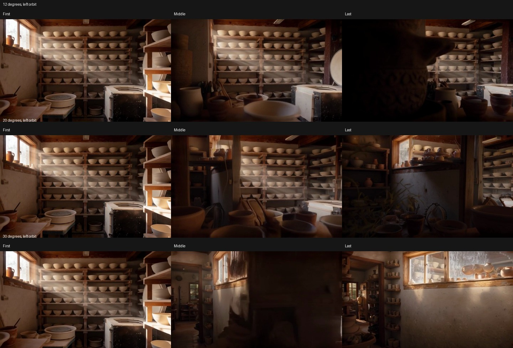

[Right orbit before/after](media/camera-moves/round2/orbit-right-retired.jpg), [crane-down before/after](media/camera-moves/round2/crane-down-retired.jpg), and [handheld before/after](media/camera-moves/round2/handheld-retired.jpg) remain as rejected evidence.

Crane up stays at 0.75 rather than the tested 1.1. The form recommends an open scene. Dolly zoom also needed a better source: the first harbor test held the foreground at 1.00x but enlarged its distant ferry by only 1.03x. The ferry leaves the grey guide's frame early. The bowl-and-shelves source keeps detailed background surfaces in view, and the prompt explicitly asks them to expand. The [first dolly-zoom comparison](media/camera-moves/round2/dolly-zoom-rejected.jpg) is retained.

### Hero shots and same-take finals

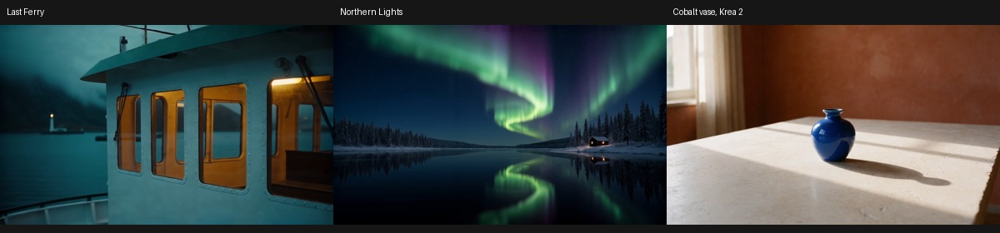

The source photos are the Last Ferry and Northern Lights stills, plus a new cobalt ceramic vase made with Krea 2 through the app. They use solid objects and clear depth layers. The first new draft and first final were submitted in the browser. The remaining review matrix used the same project API, in remote mode, one job at a time. A single SDK depth probe was used to debug the vase target; it was not substituted for a hero render.

All three are 1280x768, 97 frames at 24 fps. Their decoded audio is bit-identical to the corresponding draft. The final records its original draft as its parent.

| Shot | File in the main checkout | Downscaled SSIM |
|---|---|---|
| Ferry dolly | `outputs/camera-demo/round2/ferry-dolly-final.mp4` | 0.953780 |
| Lake pullback | `outputs/camera-demo/round2/lake-pullback-final.mp4` | 0.942860 |
| Vase crash zoom | `outputs/camera-demo/round2/cobalt-crash-final.mp4` | 0.967752 |

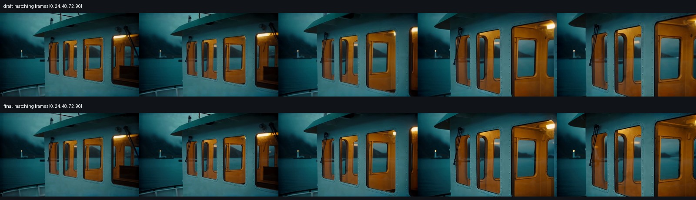

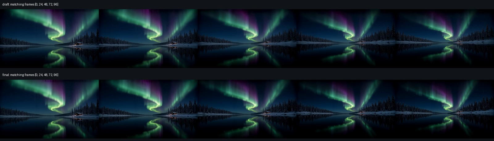

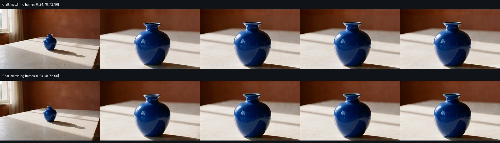

All three finals are in `outputs/camera-demo/round2/` in the main checkout, with their drafts beside them. Full project data and exploratory renders remain in this worktree's `outputs/camera-round2/app/`. The picker previews are small, silent copies of the reviewed app takes. They play on pointer or keyboard interaction and respect reduced motion.

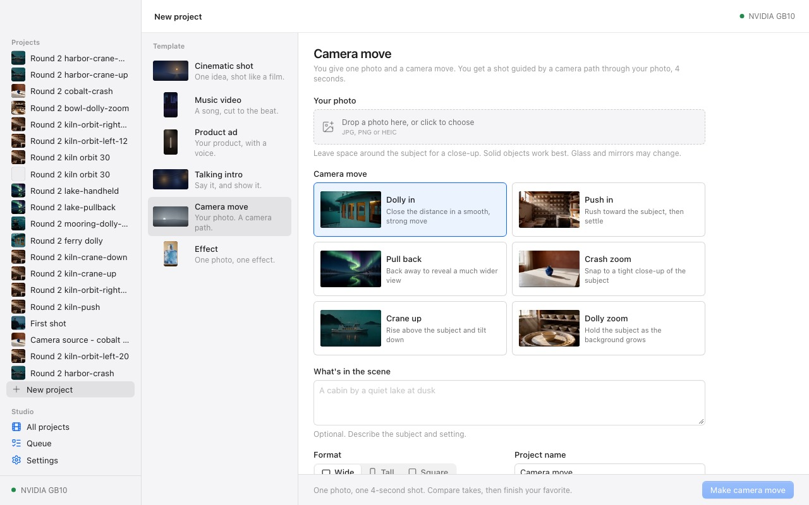

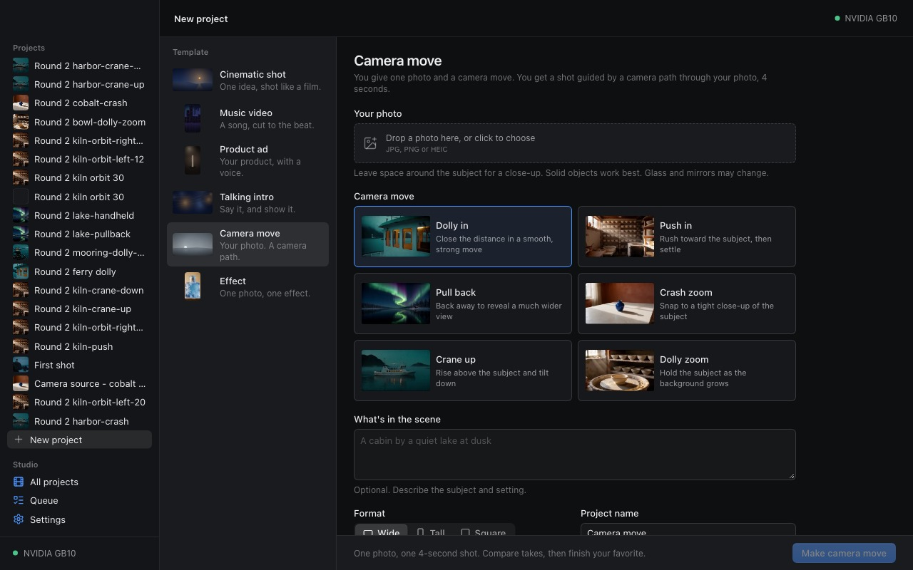

### Contract and checks

The contract change is limited to `quickMoves`: stronger labels and hints, reordered cards, and removal of `orbit_left`, `orbit_right`, `crane_down` and `handheld_drift` from Camera move. The ordinary cinematic template's camera options remain. No HTTP route, schema field, step ID, model or workflow was added.

Restart checks also caught an onboarding race: the completed First shot screen could briefly mount and submit another sample before redirecting. Both submission effects now check whether onboarding is finished. A later local-engine restart and a direct visit to setup submitted no new sample job.

The repeated root run also exposed a timing race in the existing remote-restart test. It could drop the fake ComfyUI socket before the engine had observed the accepted job running. The test now waits for that state before simulating the restart, and its outer timeout allows the existing 60-second recovery wait. Three repeated runs of the full remote test file passed. This changes the test, not the Spark service or runtime retry policy.

The Effect work and subsequent native quick-shot QA fixes are merged from main. Final validation: `pnpm typecheck`, `pnpm build`, `node scripts/validate_recipes.mjs` and `pnpm test`. The recipe check validates seven recipes and 44 workflow references. The root suite passes 263 engine, 95 editor and eight desktop tests. One optional ASR integration test is skipped; local Whisper variables are empty so the check does not run a model on the Mac. The ffmpeg and Chrome export tests ran. The build retains the upstream Zod annotation and bundle-size warnings.

The six picker previews were checked in light and dark appearances, including pointer playback and keyboard selection. The combined build still shows all six cards without horizontal overflow. The temporary review engine was stopped after its queue was empty. No ComfyUI restart, model download, cloud GPU or public upload was needed.
