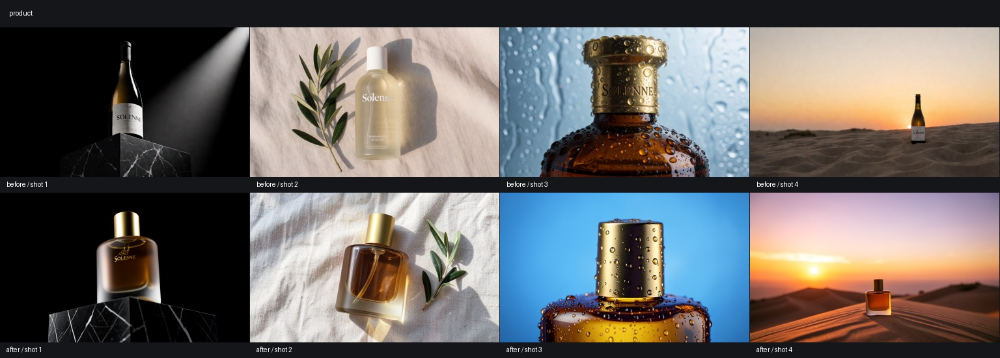
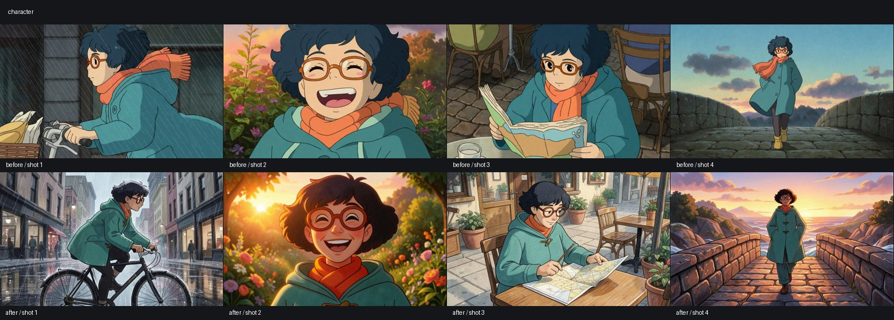
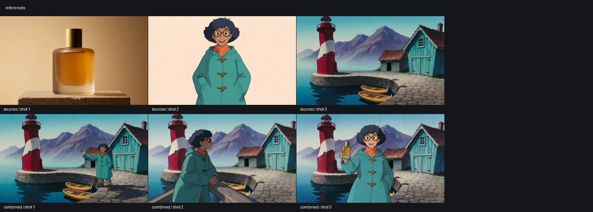
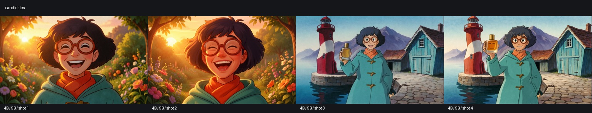
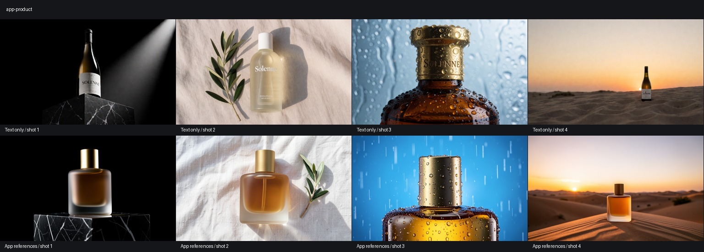
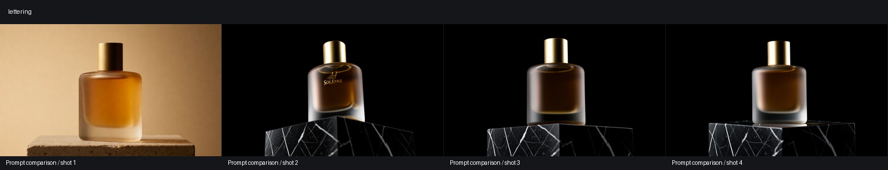
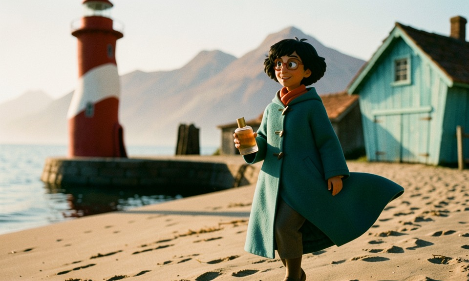
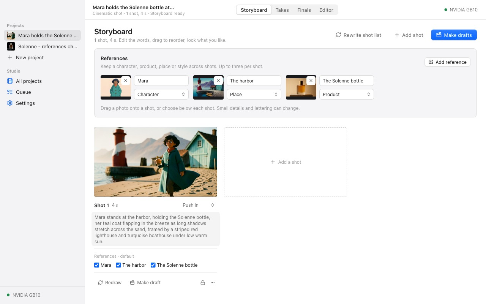
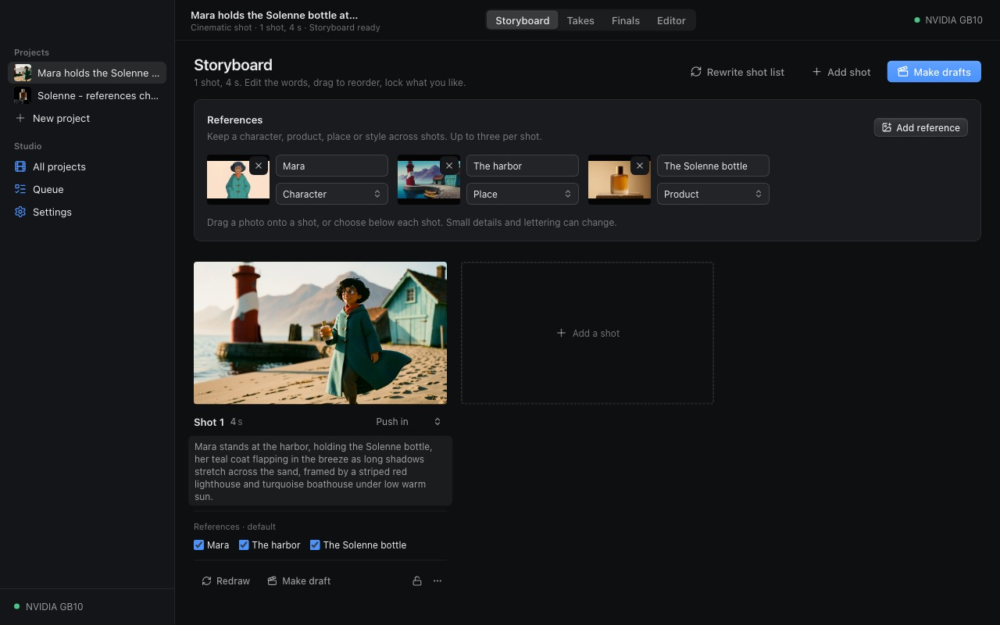

# Project references, 2026-10-21

## Method

All images in this test are real generations through the Comfy SDK and a local comfy-api-proxy. The shared GPU ran ComfyUI 0.41.3. No model ran on the Mac. Jobs were submitted serially within each comparison; other work shared the queue. Timings include that wait and model loading, so they are not inference benchmarks.

The product source is the generated, blank Solenne perfume bottle from the showcase. The character and harbor sources were generated for this experiment. No photograph of a person was used.

Krea 2 Turbo bf16 is the control, using the shot prompt without an image. FLUX.2 Klein 4B fp8 uses the same seed and shot instructions, preceded by a reference identity instruction. Each reference is scaled to about one megapixel, encoded separately, then appended to both conditioning chains with core `ReferenceLatent` nodes. The output is 960 x 576 regardless of the source shape. Sampling uses four Euler steps and CFG 1.

The control deliberately keeps the same product name without supplying its visual identity. It tests the new reference path against independent text-only stills. It does not establish an improvement over the old single-photo product workflow, which already used Klein.

[Comfy's Klein guide](https://docs.comfy.org/tutorials/flux/flux-2-klein) documents multi-reference editing. The installed `ReferenceLatent` implementation appends each encoded image to the conditioning list. No extra node pack is needed. [MOSS's guide](https://github.com/OpenMOSS/MOSS-Image/blob/main/USERGUIDE.md) describes reference generation as a post-training direction; it was not substituted for a measured reference model here.

## Product

Seeds 82200 through 82203. The four compositions are a low-angle black-marble hero shot, overhead linen flat lay, tight cap-and-shoulder detail with droplets, and a wide dune sunset.

The reference path preserves the rounded rectangular amber body and cylindrical brass cap while changing the framing and setting. The text-only controls switch between a wine bottle, a pale toiletry bottle and a round brown bottle. The initial conditioned hero frame invents a gold logo. A repeat with the same seed and an explicit instruction to preserve the blank surface removes that logo. That is one successful correction, not a guarantee of accurate lettering.

## Character results

Seeds 82300 through 82303. The shots ask for cycling in rain, a laughing close-up, reading a map at a cafe, and walking across a bridge. The controls already repeat blue hair, glasses, scarf and coat because those attributes were in their text prompts. The useful difference is the specific design: all four conditioned images retain the source's brass-toggle coat, while none of the four controls does. Face shape and skin tone still vary. The cycling and cafe shots become wider compositions instead of repeating the source portrait.

## Two and three references

The two-reference shots use seeds 82400 and 82401. Both retain Mara's glasses, scarf and coat and the harbor's red-and-white lighthouse, turquoise boathouse, stone quay and yellow boats. The second moves Mara into the foreground and blurs the harbor. The three-reference shot, seed 82500, adds the bottle in her hand. Its amber body and brass cap remain recognizable, although its proportions are narrower than the source.

I also ran the installed Klein 9B with its Qwen3 8B encoder on the close-up and three-reference scene. The close-up additionally asks to preserve skin tone, so it is not a strict model-only comparison. Neither result showed a clear identity gain over 4B. The three-reference 9B image adds lettering to the bottle. These two examples do not establish a general model ranking.

The chosen workflow is Klein 4B with separate reference latents on both conditioning chains. It already exists in the recipe, uses core nodes, handles all three inputs, and changes composition. Missing optional images are removed from the graph; they are not replaced with copies of the first image. The output canvas has its own dimensions. The existing single-image edit graph remains available for composition-preserving edits.

## Real application replay

The Solenne replay uses the same four shot prompts and seeds 82200 through 82203 through the real engine in remote mode. All four stills completed. The engine used the project's named product reference and the production prompt that forbids new lettering. The three full-bottle views retain its rounded rectangular body and cylindrical cap; the detail view keeps the matching cap and glass shoulder. All four are visibly the same product family, compared with none of the four text-only controls matching the source bottle. That count is a visual judgment, not an embedding score. The images still invent small internal glass details.

The no-new-lettering instruction removes the invented gold logo in the same-seed hero comparison. No added label is visible in the four final application outputs. This is evidence from these examples, not a guarantee for other products.

A second project was created entirely through the New project UI with all three references. The local writer named Mara, the harbor and the Solenne bottle, and the engine made the still through the three-image workflow. The cinematic template changed the drawn source into a more three-dimensional rendering. The coat, glasses, harbor landmarks and amber/brass bottle remain recognizable, but the visual medium is not locked by a character reference.

The UI was checked at 1280 x 800 in both themes. Checks covered upload in New project and the storyboard, naming, kind, individual selection, restoring defaults, drag onto a shot, removal, and two rapid deselections. The rapid-click check found a stale-state bug; selection changes now apply to the latest saved shot.

## Scope and limits

- Up to six references per project, up to three per shot. An absent selection uses the first three; an empty selection uses none.
- Spark, NVIDIA 32 GB and NVIDIA 24 GB offload recipes have the workflow and its model files. Only the Spark was tested with real inference. The other two hardware paths are unmeasured. Other tiers can save references, but clearly report that they cannot render them.
- Old product-photo projects become named references; the product end card still uses the original upload.
- Reference photos guide stills. Drafts and finals continue from those stills through the existing video paths. This experiment does not claim improved temporal identity in video.
- Lettering, skin tone, fine details and proportions can drift. A character reference does not by itself lock the visual medium.
- The control is text-only Krea. This is not a claim that the new workflow improves on the old Klein single-photo product rendering.

Contract changes are the reference field on create/update request bodies, validation limits on the existing reference/selection schemas, the reference-image capacity on tier summaries, and the DELETE uploaded-reference route. Existing project and shot reference field meanings are unchanged. Nonempty references are attached after the project is created and its photos are uploaded.

Job ids, prompts, seeds and measured wall times are in [spike runs](media/references/runs.json), [lettering check](media/references/prompt-check.json), [9B checks](media/references/nine-b-runs.json) and [application replay](media/references/app-runs.json). `scripts/reference_spike.py` reproduces the serial spike with a supplied generated or licensed product photo. The timings include queue waits and are not hardware speed estimates.

The two real projects also retained their references and shot records after an engine restart. All six application jobs completed. The local test engines and the experiment's tunnel were stopped afterwards. The shared GPU service was left running.

## Final validation

- Root `pnpm test`: 340 tests passed, including 240 engine tests, 92 editor tests and 8 desktop tests. All four full template round trips ran with ffmpeg and Chrome.
- Root `pnpm typecheck` and `pnpm build` passed. The build still emits the pre-existing Vite bundle-size advisory.
- `node scripts/validate_recipes.mjs`: seven recipes and 40 workflow references validated.
- The new tests cover reference ownership, labels, duplicate ids, removal, legacy photos, zero/one/two/three selected inputs, input order, writer names, and unsupported recipes. The rapid-selection race was reproduced and checked in the browser.
- `ruff check scripts/reference_spike.py` and Python syntax compilation passed.

The durable real-app data is `outputs/references/app-data`. From the repository root it can be reopened with `node packages/engine/dist/cli.js --port 8747 --data-dir outputs/references/app-data --web-dir apps/web/dist`. Its saved remote setting selects the same GPU computer. All project assets and job records remain there; the smaller proof records are committed above.
