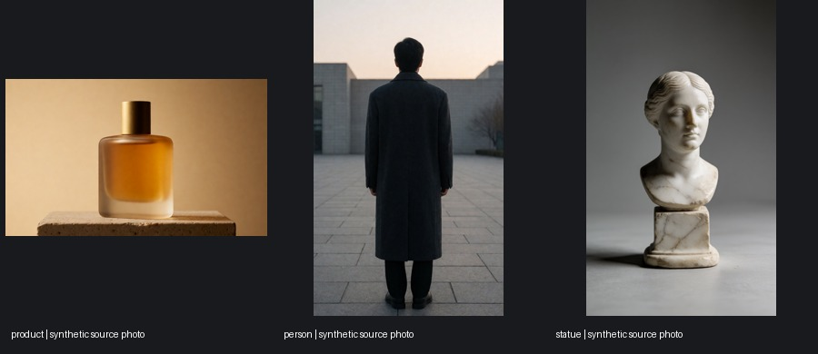

# Effect quick shot, 2026-10-21

Ten presets are implemented: Disintegrate, Freeze, Ignite, Melt, Shatter, Bloom, Solid gold, Crystallize, Levitate and Earth zoom out. LTX 2.5 generates every video. There is no MiniMax fallback in this workflow.

The comparison contains 32 four-second clips across three synthetic photographs. Eight presets have strong general examples. Melt and Shatter are kept for solid objects, with that limitation in the gallery copy. Glitch was dropped. These are curated examples, not a claim that every preset succeeds on every photograph or seed.

## Pipeline and application

For an effect with a clear end state, FLUX.2 Klein 4B edits the photo into the after image. LTX 2.5 then uses the original photo at frame 0 and the edited image at frame 96. The graph follows the installed `video_ltx2_5_flf2v` template: two `LTXVAddGuide` nodes, indices 0 and -1, strengths 0.9 and 0.7, eight distilled sampling steps. `LTXVCropGuides` removes appended guide frames before decoding and saving the joint audio-video latent.

Levitate and Earth zoom use the existing LTX image-to-video draft graph directly, without an end image. Both paths save a normal draft take and latent. The same-take final, editor and export use the existing project flow. Every generation goes through the Comfy SDK and comfy-api-proxy.

The engine implementation is in `packages/engine/src/projects/effects.ts`. It keeps separate persisted Comfy job IDs for the edit and video stages, so reconnecting during video generation does not repeat the image edit or attach to the wrong job. The shot's still remains the uploaded photo. Its optional description is frozen into the queued job along with the effect choice.

New project defaults to 9:16, accepts one photo, shows a visual effect gallery and opens Takes after creation. All ten cards have silent looping previews from the actual test outputs. Pointer and keyboard focus start playback; reduced-motion settings suppress autoplay. The selected render and poster frame for each card are recorded in [the gallery manifest](2026-10-21_vfx_gallery.json). `scripts/vfx_gallery.py` rebuilds the media. Both themes were checked in the browser: [light](media/vfx/ui-light.jpg), [dark](media/vfx/ui-dark.jpg).

## Inputs and results

The inputs are an amber perfume bottle on a plinth, a person seen from behind, and a marble bust. All are generated photographs. This is not a test of fidelity to a real person's photograph. Krea 2 Turbo made the person and bust at 768x1280 with seeds 7341 and 7342. The bottle is the existing Solenne showcase source. The video graph resizes and center-crops the input to its render shape.



The bottle and person passes each tested eight end-state effects and three prompt-only effects. The statue pass tested the ten retained presets through Nightshift's real HTTP API, exercising project creation, upload, automatic generation, saved takes and latents. Glitch was not repeated on the statue after failing on the first two inputs. Every statue project completed. Exact prompts, job IDs, seeds, output paths and per-clip notes are in [runs](2026-10-21_vfx_runs.json), [review](2026-10-21_vfx_review.json) and [candidate instructions](2026-10-21_vfx_candidates.json).

| Effect | Bottle | Person | Statue | Decision |
| --- | --- | --- | --- | --- |
| Disintegrate | Clear dust breakup | Strong dust plume and collapse | Erodes, tilts and crumbles | Keep |
| Freeze | Frost growth and cold mist | Stylized snowflake coat | Ice shower and growing frost | Keep |
| Ignite | Flames climb the bottle | Strong ignition; large initial burst | Strong fire, smoke and reflected light | Keep |
| Melt | Cap floats upward | Mostly kneels and collapses | Smooth sinking into a glossy pool | Keep for solid objects |
| Shatter | Glass becomes stone fragments | Figure becomes stone fragments | Strong marble burst and falling rubble | Keep for solid objects |
| Bloom | Vines and flowers grow | Strong growth across the coat | Strong growth around bust and plinth | Keep |
| Solid gold | Strong liquid-metal coating | Coat folds and hem change | Reflective gold; some face detail changes | Keep |
| Crystallize | Strong spreading facets | Coat becomes a fitted suit | Strong faceted sculpture | Keep |
| Levitate | Clean lift and detached shadow | Clean lift, then head clips the frame | Whole object lifts; top clips late | Keep; leave headroom |
| Earth zoom out | Pullback to Earth on two seeds | Earth appears behind the person | Pullback with an invented city transition | Keep; product preview |
| Glitch | Almost static | Weak colored edges | Not run | Drop |

Melt is a stylized sinking effect, not a physically accurate simulation: the statue's head stays rigid until late. Gold and crystal can change clothing or facial detail. Earth zoom invents the geography and can fail by inserting a planet into the original scene. The gallery copy favors the inputs that worked; the rejected clips are retained in the comparison rather than hidden.

Contact sheets use exact frames 0, 24, 48, 72 and 96:

- [Bottle, all 11 effects](media/vfx/product-comparison.jpg)
- [Person, all 11 effects](media/vfx/person-comparison.jpg)
- [Statue, all 10 retained effects](media/vfx/statue-comparison.jpg)

The first bottle-freeze probe is reused in the comparison. The other SDK comparisons use fixed per-effect seeds; app runs use the saved seed in their take record. Resumed SDK waits for the bloom edit, a shatter edit and the person melt video report only the remaining wait and download time. Those partial times are not used for recipe estimates.

## Three demo shots

The selected files are same-take finals at 768x1280, 97 frames, 24 fps, about 4.04 seconds. The editor can crop them to 9:16 and export four seconds at 1080x1920.

1. `outputs/vfx-demo/01-freeze-product.mp4` - frost spreads over the amber bottle with drifting cold mist.
2. `outputs/vfx-demo/02-disintegrate-person.mp4` - the figure breaks into a dust plume, then settles into powder.
3. `outputs/vfx-demo/03-ignite-statue.mp4` - fire climbs the marble bust and lights its face.

The decoded audio hashes match each draft exactly. Average frame SSIM after Lanczos downscaling the final to the draft size is 0.762671 for Freeze, 0.922435 for Disintegrate and 0.814398 for Ignite. These scores and the frames show retained action and framing, with changed fine detail; they are not pixel-identity claims. [Verification record](2026-10-21_vfx_finals.json), [dust comparison](media/vfx/disintegrate-draft-final.jpg), [fire comparison](media/vfx/ignite-draft-final.jpg), [freeze comparison](media/vfx/freeze-draft-final.jpg).

The real browser flow completed upload, automatic Freeze generation, same-take final, editor and export. `outputs/vfx-spike/app/effect-freeze-9x16.mp4` is the four-second 1080x1920 export, with audio and no captions. No voice or music was requested. Earth zoom also completed through the real browser with the subject description left empty; its project contains only the original image, video and latent. The ten statue presets completed through the same engine API. After merging both the references and camera work, the final build also completed a fresh browser upload and Freeze render in project `prj_mvhp1bkg6dafce0ac7`, with the original photo, end image, video and latent saved under `outputs/vfx-spike/app-merged/`.

## Hardware and measurements

Only `unified-128-cuda` was measured on the Spark. Its edit uses Klein 4B FP8 and its video uses LTX 2.5 distilled INT8. Runtime versions were ComfyUI 0.41.3 and Comfy SDK 0.5.0.

| Step | Recorded time | Sampled process peak |
| --- | --- | --- |
| End image | 30.2 s | 18.8 GB |
| LTX first/last-frame video | 78.6 s | 45.1 GB |

Times are conservative SDK wall times from the initial freeze probe, including loading and shared-queue waits. Peaks come from a separate real-app freeze run: one five-second sample for the edit and seven for video. They include cached models and can miss short peaks. They are not discrete GPU fit measurements. [Measurement method and IDs](2026-10-21_vfx_measurements.json).

`nvidia-32` and `nvidia-24-offload` include the same graphs and the three pinned Klein files, with estimated timings and memory. Their existing LTX low-VRAM paths are used. Neither card was tested. Apple and smaller NVIDIA tiers omit the effect steps, so the UI hides Effect there. The Spark service was shared normally; no restart, shared-model mutation or cloud GPU was used.

## Reproduce

With a running Comfy proxy, compare source images directly through the SDK:

```sh
COMFY_BASE_URL=http://127.0.0.1:8191 uv run --no-project --python 3.12 --with comfy-sdk \
  python scripts/vfx_spike.py \
  --photo person=person.png --photo product=product.png --photo statue=statue.png \
  --out outputs/vfx-comparison
```

Or exercise the complete project path on an engine already attached to that proxy:

```sh
python scripts/vfx_app_spike.py --engine http://127.0.0.1:8752 \
  --photo statue.png --subject statue --out outputs/vfx-app-comparison \
  --effects freeze ignite disintegrate melt explode bloom gold crystal levitate earth_zoom
```

Each driver submits one case at a time and records the pending job or project for resumption. Use a new output folder when changing inputs. `scripts/vfx_contacts.py` creates the contact sheets. These tools do not restart services or download models.

## Contract and regression checks

This work changes only `quickEffects` data in the contract: the original `disintegrate`, `freeze` and `ignite` IDs remain, and `melt`, `explode`, `bloom`, `gold`, `crystal`, `levitate` and `earth_zoom` are added. `explode` is displayed as Shatter. No schema fields, routes, template IDs or step IDs were added. The existing `lastImage` input now uploads as an SDK file. The references and camera changes were merged from main separately.

The original Effect form had no inputs and its engine path made a replacement still. Both were reproduced before implementation. Regression coverage now checks upload, automatic rendering, original-photo preservation, a saved take and latent, same-take final and export for guided Freeze and direct Levitate. It also checks reconnecting between the edit and video stages without a duplicate edit.

Two existing timing-sensitive tests were made deterministic: the cut/analysis overlap uses an explicit gate, and SDK cancellation waits for the event stream to start rather than racing a 20 ms timer. The final combined references, camera and effect branch passed `pnpm typecheck`, `pnpm build`, `node scripts/validate_recipes.mjs` (7 recipes, 44 workflow references), and `pnpm test` (257 engine tests, 93 editor tests and 8 desktop tests). The build retains the upstream Zod annotation and bundle-size warnings. The four VFX utility scripts also passed Python compilation.

Validation uses empty `NIGHTSHIFT_WHISPER`, `NIGHTSHIFT_WHISPER_MODEL`, `NIGHTSHIFT_WHISPER_VAD` and `NIGHTSHIFT_VAD_MODEL` variables. An initial test run auto-detected a local Whisper install; that run was stopped and subsequent validation disabled local ASR. One optional ASR integration test is skipped.
