# What if? continuous-film spike, 2026-10-28

Decision: use one continuous LTX generation. The gravity chain passed the visual
gate and the template is implemented. Three real-app demo films have been exported and verified.

## Method

Krea 2 Turbo makes an anchor image at 768 by 1280. FLUX.2 Klein 4B edits each
previous frame into the next state. LTX 2.5 renders at 384 by 640, 24 fps. The
segmented comparison uses the existing effect graph, 97 frames per segment,
with first and last image guidance. The continuous comparison adds intermediate
guides at frames 96 and 192 to a 289-frame generation.

Every generation uses the Comfy SDK through the existing proxy. Jobs run one at
a time. Graphs, prompts, seeds, job IDs, outputs and SDK wall times are retained
in the spike folder. Times include model loading and any queue wait.

The visual gate is a coherent 12 to 20 second film: a legible impossible change,
motion through its hand-offs, no visible cut and no distracting object drift.
A shared guide image alone does not establish matching rendered endpoints.

## First gravity chain

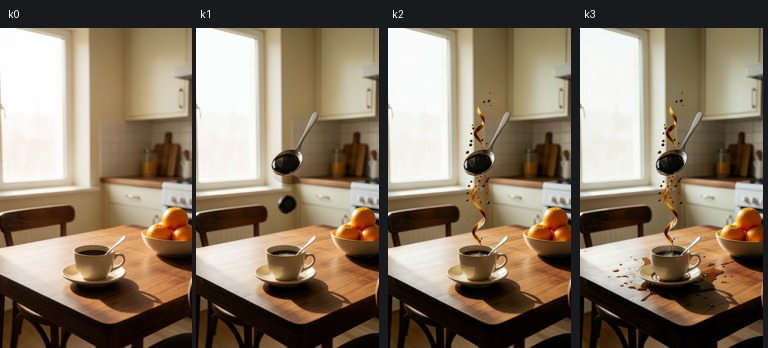

The kitchen stays recognizable, but the first edit invents an oversized floating
spoon while retaining the original spoon in the cup. The next edit adds ribbons
of coffee but leaves the cup and oranges on the table. The last edit adds a spill
without removing the floating spoon. These frames fail the intended story.

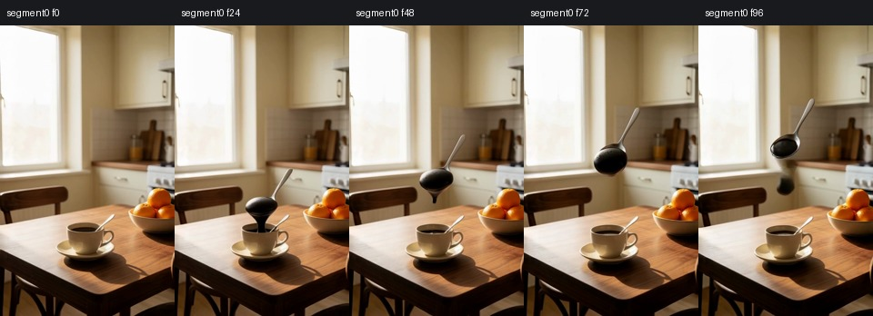

The first segment has visible motion but inherits the invented spoon. Motion
alone is insufficient to pass the visual gate.

After discarding each later segment's first frame, the join between segments 1
and 2 has mean absolute RGB change 4.39 on a 0 to 255 scale; the adjacent frames
within those clips change by 0.61 and 0.51. The second join changes by 3.76,
against neighboring changes of 0.36 and 1.03. These numbers describe decoded
frames, not perceptual quality scores. They show that the endpoints are not
identical and trimming a frame does not establish a seamless join.

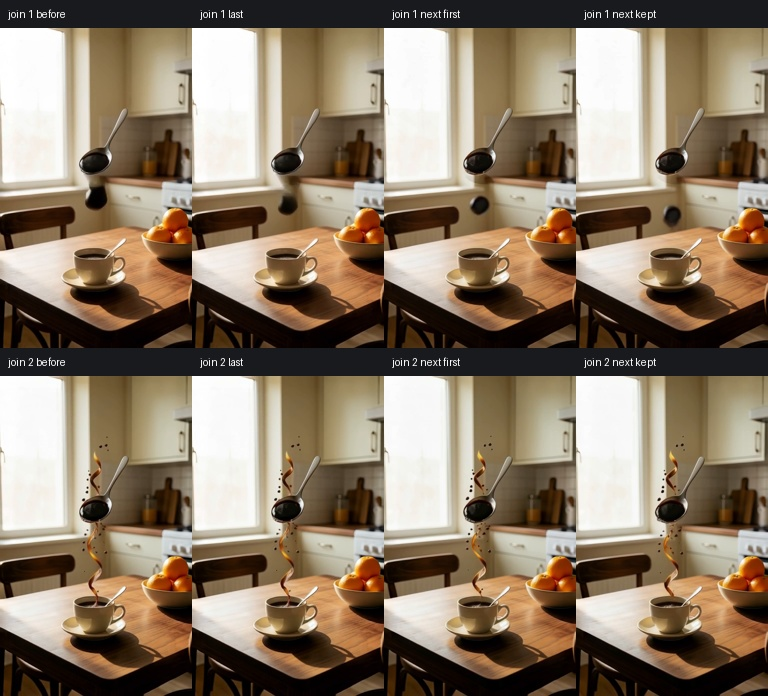

The corresponding single generation completed in 99.24 seconds. It contains
289 frames at 24 fps, audio and a joint latent. It avoids joining independent
clips, but the invented spoon still spoils the scene and becomes faint near
the ending. This first chain does not pass the visual gate.

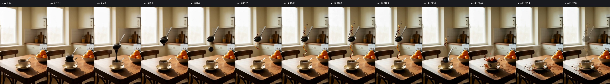

## Simpler gravity chain

A second chain uses one cup and no spoon or oranges. Single-reference edits
lift the cup cleanly but leave it floating in the intended landing frame. A
third chain supplies the anchor as a second reference to every edit and fixes
the output canvas at 768 by 1280. Its final image places the cup on the table
again, although to the right of the original position.

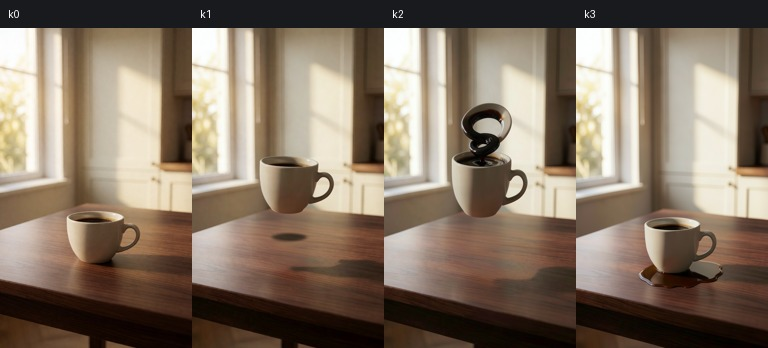

The longer comparison places guides at frames 0, 120, 240 and 360, for 15.04
seconds at 24 fps. This leaves room for the requested short narration.

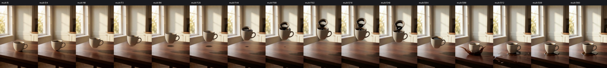

The cup lifts, coffee rises into a dark ring, then the cup lands and splashes.
The room stays in place. The liquid ring is stylized, and the cup lands to the
right of its original position. Those are visible limits, not physical accuracy.
This result passed the visual gate.

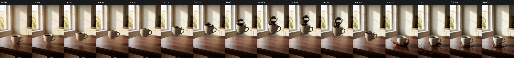

The final is 768 by 1280, with the same 361 frames and duration as the 384 by
640 draft. Decoded audio SHA256 matches exactly. After Lanczos downscaling, mean
frame SSIM is 0.960978. The action and framing survive; this is not pixel identity.
[Verification record](2026-10-28_what_if_final_check.json).

## Harbor and Jupiter keyframes

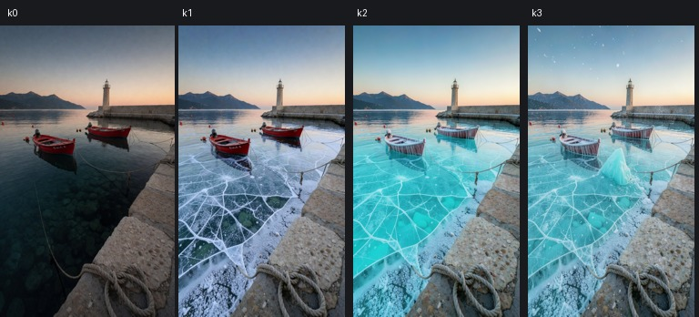

The harbor keeps its quay, horizon and boats in place. Ice changes the boats'
surface detail, and the final ridge is smaller than requested. The continuous
film freezes the water smoothly, but its ending is too quiet for the main demo.

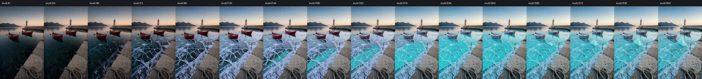

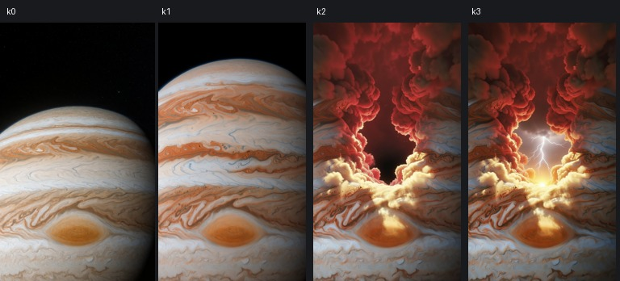

The first Jupiter chain opens a cloud tunnel while retaining visible planet
bands. That is a different image from a first-person dive into the clouds. The
initial shared edit instruction asked to preserve the camera, which conflicts
with this premise. A moving-camera variant removes that constraint.

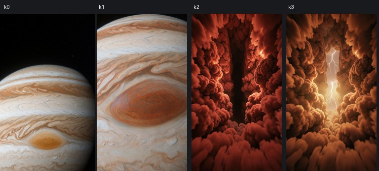

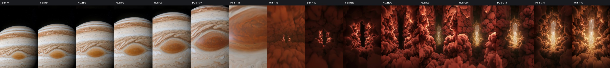

Removing the fixed-camera instruction makes the planet fill the view before
the camera enters the storm. The cloud corridor and lightning are imagined
scenery. This is a fictional journey, not a simulation of Jupiter's atmosphere.

## Miniature forest

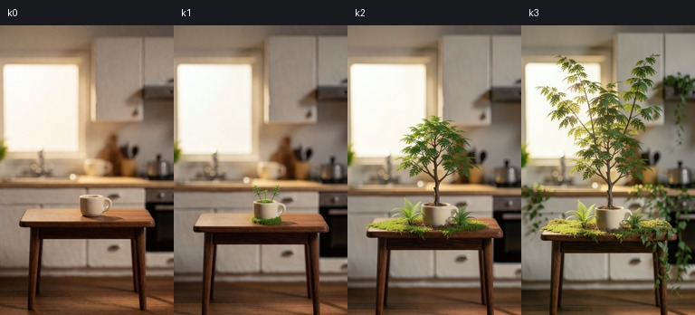

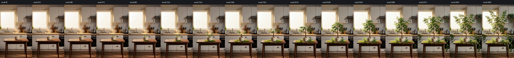

This additional premise checks the second look. A seedling grows from a cup
into a tree, with roots, moss and vines across the table. The first change is
small and the opening takes too long to develop. Growth is smooth, but the
result is a tree filling part of the kitchen, not the entire forest requested.

## Measurements

| Operation | Observed SDK wall time | Sampled process memory |
| --- | --- | --- |
| Four-guide, 15-second draft | 145.54 s | 45.0 GB |
| Same-take final, 15 seconds | 277.69 s | 51.0 GB |

Time and memory come from different runs. Memory is scheduler-accounted
process usage, sampled every five seconds. Nineteen samples cover the corrected
Jupiter draft; forty cover the gravity final. Sparse samples can miss short
peaks. Times include loading and queue wait. These are not dedicated-GPU
benchmarks or measurements of other tiers. The recipe enables What-if only on
`unified-128-cuda`. [Measurement record](2026-10-28_what_if_measurements.json).

No new model was downloaded for this feature. The existing runtime was used
without changing its services or model files.

## Application and contract

The film is one `Shot`, with four `keyframes`. A still request redraws the chosen
beat and everything after it. Each image stage has a separate persisted Comfy
job ID; an interrupted chain keeps its completed images. A draft captures its
ordered guide IDs, prompt, look and aspect before queueing. A later redraw
cannot change that take's same-take final.

The local writer returns four beats and 35 to 50 spoken words. Its per-request
output limit is 1024 tokens; other templates keep their 384-token default. An
unusable or failed answer uses a complete starter story. New projects queue the
stills, voice, instrumental music and first draft. Captions and audio are on the
editor timeline before export. Without speech recognition, word timings are
estimated and the export says so.

Contract additions:

- Template ID `what_if` and step ID `video_what_if`.
- `KeyframeSchema` and optional `Shot.keyframes`.
- Optional `Take.guideAssetIds`, in input order.
- Optional `StillRequest.keyframeIndex`, from zero to three.
- What-if brief inputs `question` and `look`; the existing `photoAssetId` selects an optional opening image.
- Named workflow input `maxTokens`, used only when a caller supplies it.
- Shared example questions, looks, timing constants and fallback stories.

No route was added or removed. Other templates retain their existing shapes.
What-if has Cinematic and Miniature world looks and accepts an optional opening
photo. Remaster is disabled for the full film; same-take finishing uses the
existing latent continuation workflow.

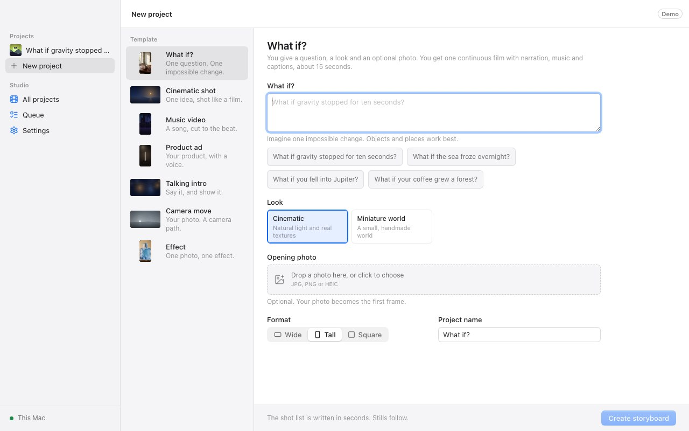

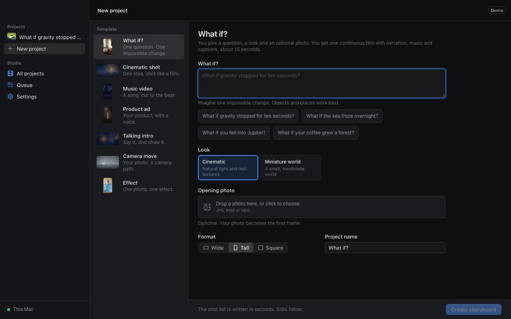

These screenshots are the real UI with the mock engine at 1280 by 800. The
storyboard, Takes and editor were also checked. A browser replay created a
project and reached one film, two audio tracks and captions without page errors.

The checks found a pre-existing take-selection issue: choosing another draft
kept the previous draft's final selected. An API end-to-end test reproduced it
in both orientations. Changing the draft now clears an incompatible selected
final, while keeping that final in the project's history.

## Reproduce the visual comparison

The [prompt collection](2026-10-28_what_if_prompts.json) includes rejected
versions as well as the retained ones. With an existing Comfy SDK proxy:

```sh
COMFY_BASE_URL=http://127.0.0.1:8191 uv run --no-project --python 3.12 --with comfy-sdk \
  python scripts/what_if_spike.py --spec research/2026-10-28_what_if_prompts.json \
  --case gravity-anchor --out outputs/whatif-spike --phase stills
```

Run the same command with `--phase multi`, then `--phase final`. For the original
segmented comparison use case `gravity`, phases `stills`, `segments` and `multi`.
`scripts/what_if_join.py` joins segments after dropping each later first frame
and records their boundary differences. `scripts/what_if_contacts.py` samples
exact frames for review. Every driver reuses completed stages and reattaches to
pending jobs. Changing inputs requires a fresh output folder.

## Baseline checks

Before product changes, the root build and typecheck pass. Recipe validation
passes for seven recipes and 44 workflow references. Root tests pass: 263 engine,
95 editor and eight desktop tests. One optional editor integration test is
skipped. Local speech-recognition model paths were disabled for this run.

## Real application runs

The three demo projects were created with the New project form in remote mode.
Gravity uses an optional opening photo from the spike. Jupiter and the miniature
forest start with Krea. The local writer returned valid four-beat stories for all
three. Each project generated its four stills, Breeze narration, instrumental
music and continuous draft through the engine's SDK runner.

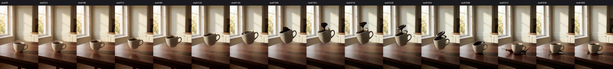

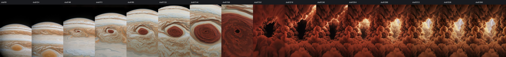

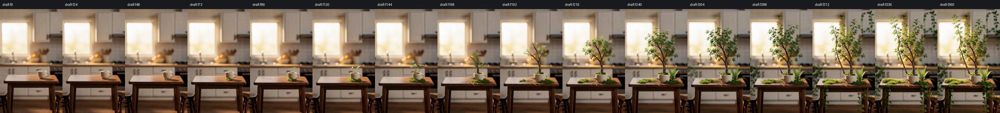

Jupiter is the strongest opening: the planet approaches before the camera enters
an illuminated cloud canyon. Gravity is the clearest demonstration of continuity:
the same cup lifts, sheds coffee, lands and splashes. The miniature forest is
quieter. Its first growth is small, and the tree fills part of the kitchen rather
than becoming an entire forest.

The Finals page replay exposed another existing state issue: switching projects
after queueing one retained an empty shot selection. The page now resets its
local selection when the project changes. The browser replay then queued Jupiter
and the forest in sequence without manually selecting their shots.

A queued same-take final leaves beat editing and new drafts available. Only a
full story rewrite waits for active jobs, because it replaces the shot. The
real browser check covers enabled beat fields and the new-take button in both
themes while the forest final is queued.

## Final checks

Root `pnpm typecheck`, `pnpm test` and `pnpm build` pass. Tests: 273 engine,
95 editor and eight desktop. One optional speech-recognition integration test
is skipped; local speech-recognition model paths were disabled. The Python
spike helpers pass Ruff. Recipe validation passes for seven recipes and 45
workflow references. The real editor also exported a 15-second, 960 by 540
landscape preview through its 16:9 control.

A further API replay queued a final, picked another draft, then let the final
finish. Previously the arriving final selected itself over the newer draft.
The finished take now stays in history and becomes selected only when its
source draft is still selected. The regression runs in both orientations.

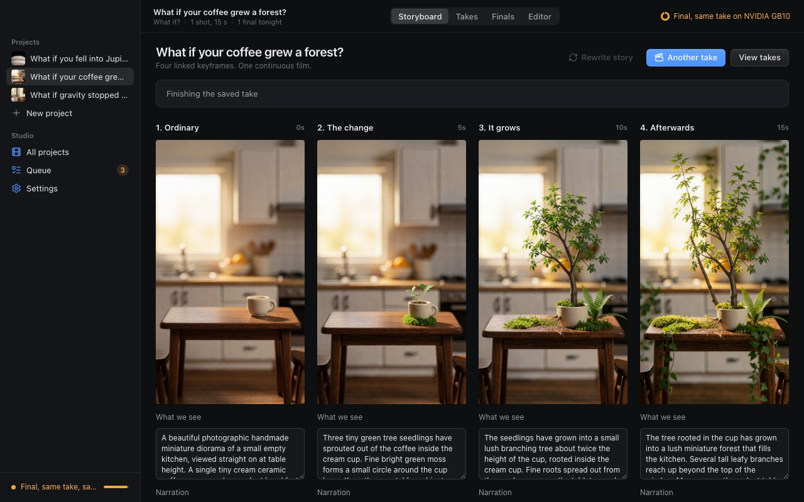

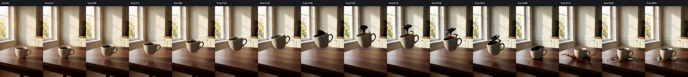

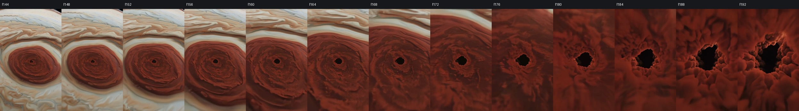

The strongest transition was also inspected every four frames from 144 to 192.
The approaching storm grows into the surrounding cloud walls without a hard cut.


## Finished demo handoff

All three projects completed through the real app in remote mode. Each was
queued with Finish overnight, finished from its saved joint latent, and
exported through the editor at 1080 by 1920. The files and short notes are in
`outputs/whatif-demo/` in the main checkout. Jupiter is the strongest opening
hook. A 1920 by 1080 Jupiter export is also included under `extras/`.

| Film | Spoken words | Caption blocks | Draft/final SSIM after downscaling |
| --- | --- | --- | --- |
| Gravity | 40 | 11 | 0.963579 |
| Jupiter | 40 | 12 | 0.838061 |
| Forest | 39 | 10 | 0.920166 |

All three drafts and finals have 361 frames at 24 fps; their decoded audio
hashes match. Saved seeds and ordered guide IDs match too. Each export uses
the selected final, has 360 frames over 15 seconds, and includes stereo AAC
audio. Same-take finishing preserves the action and framing; it can change
texture, especially in Jupiter's clouds. These comparisons do not assert pixel
identity. [Real-app verification](2026-10-28_what_if_app_check.json).

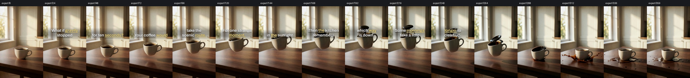

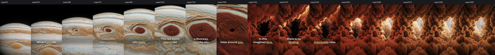

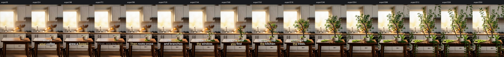

Caption timing in these exports is estimated from the narration text. Speech
recognition was disabled to keep model inference off the Mac. The native
editor can use its existing speech-recognition integration when available.
The forest's opening is slower than the other two, and its growth fills only
part of the room. The harbor test was not selected for the demo. Remastering
and other hardware tiers remain unavailable for this template.

A real final arriving during a caption-size save exposed a quick re-cut race:
the old cut's style overwrote the saved size. A gated API end-to-end test now
reproduces that timing, and the quick cut keeps the current style. The forest
export was rendered again with the intended large captions.

The real runs cover creation through same-take finishing and export. Redraw,
alternate-take selection, queued-final races and writer-failure recovery are
covered through the real engine API with its mock GPU runner.

The project-switch replay also found an editor state leak: the voice field kept
the previous project's text. The editor now resets its local controls for each
project and initializes What-if narration from the actual voice track. The
reopened-project check verifies each voice field against that film's narration.


The copied app data was reopened against the current build. All three projects
kept one draft, one selected final, their narration and the large caption
setting. The browser reported no page errors. Temporary test engines, browsers
and the spike tunnel were closed. The shared ComfyUI service was not restarted.

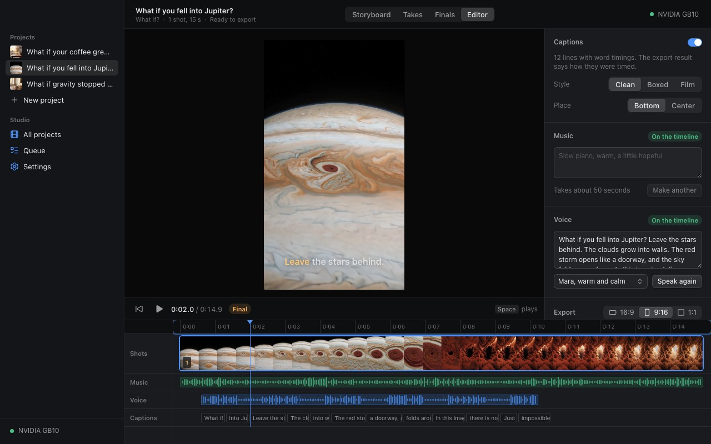
