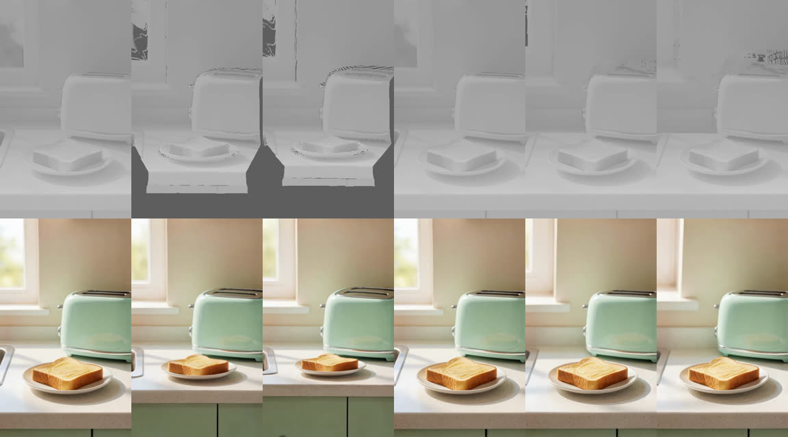
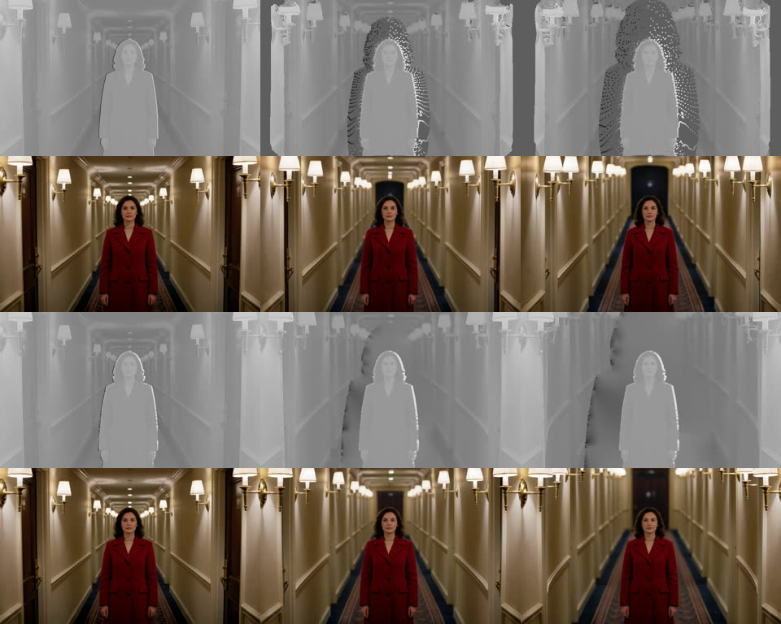

# Dolly zoom, 2 November 2026

The dogfood of 1 November found the Dolly zoom camera move to be "just a slow pull-back" (problem 14). This note says
why, what changed, and what real renders on the Spark show now.

## Why it failed

The move is two steps. The engine renders a grey layout video from the photo's MoGe depth along a camera path, and
LTX 2.5 with the Layout-To-Render IC-LoRA paints the shot from that guide. The camera path was right: back 4.5 scene
units with a lens zoom that holds the subject's depth. The guide was not.

On the dogfood's toast photo (a slice of toast on a plate, a toaster and a window behind):

- Everything nearer than the hold depth shrank: the toast, the plate and the counter. A photo has nothing outside its
  frame, so the bottom 40% of the guide turned flat grey. LTX filled it with new counter and cupboards, which is what a
  pull-back looks like.
- The hold depth was the toaster's, not the toast's, so the toast shrank too: 0.78x by the last frame.
- The wall a step behind the toaster barely grew. A dolly zoom only shows when the background is far behind the
  subject.

On a deep, centred scene the old guide already worked. The new corridor test below shows it.

## What changed

All of it is in `packages/engine/src/comfy/camera.ts` (`dollyZoomPoints`) and the prompt in `camera-move.ts`.

- Everything nearer than the hold depth moves with the subject. The subject, the table it stands on and the frame's
  edges stay put, so no grey border opens. Only the background grows.
- Depth behind the subject is stretched, as a power of its ratio to the hold depth. The power is chosen per photo so
  the middle of the background grows about 1.7x by the last frame (`DOLLY_ZOOM_GROWTH`), between 1 and 6. A long
  corridor gets 2.55; the shallow kitchen hits the cap of 6.
- The hold depth sits 8% behind the subject's mean depth, so the whole subject holds.
- Pixels blended across a depth edge snap to one side, with that side's shade, instead of scattering as dots.
- The gap the move opens behind the subject gets a background plate: depth and shade spread in from the background
  around it with a push-pull fill. Left flat grey, LTX painted an object there; with "the world behind them" in the
  prompt, it painted a planet Earth.
- Cracks up to 16 pixels, where stretched background spreads apart, fill from the far side.
- The camera backs away along its line to the subject with a lens shift, so an off-centre subject holds and the
  background grows out from it.
- The prompt describes the picture ("the subject and everything in front of it keep exactly the same size and place in
  the frame ... while the background behind them stretches and looms larger") and no longer says the camera pulls
  back.

No workflow, model, recipe or step changed.

## Real renders

Through the app (an engine attached to the Spark's comfy-api-proxy), 640x384 or 384x640, 97 frames at 24 fps, one job
at a time. Each image: guide on top, render below, frames 0, 48 and 96.

Scale is the subject's last-frame size over its first, from `scripts/measure_camera_move.py` (optical flow, which kept
more inliers than SIFT here).

| Take | Subject | Background |
|---|---|---|
| Toast, before | Toast 0.78x (72 inliers). The counter front and cupboards slide in from below. | Toaster 1.00x |
| Toast, after | Toast 1.00x (333 inliers). Plate and counter hold. | Toaster 1.01x; the window slides out of frame |
| Corridor, before | Woman 1.00x | Far end of the corridor about 25 px to 90 px wide, by hand |
| Corridor, after | Woman 1.00x | About the same; lamps stretch and the far door looms |

The flow fits on the walls had too few inliers to trust (8 to 16), so the background column uses what can be seen and
measured by hand.

## Honest limits

- The pull-back is gone: the subject holds in both scenes. On a deep scene the move is a strong vertigo shot. On a
  shallow room with a plain wall it is mild: the toaster sits at the hold depth, so it holds too, and the wall that
  grows has no texture to show it. The photo hint already asks for "a clear foreground subject with a detailed, distant
  background behind it".
- The hold depth comes from the existing subject finder, shared with the crash zoom. In the toast photo it found the
  toaster and toast together. Holding only the nearest object would make the toaster grow behind the toast; that was
  not tried, to keep within a handful of jobs on the shared GPU.
- Six camera drafts ran on the Spark for this work, plus two depth passes and one Krea still for the corridor photo.

The picker preview for Dolly zoom is now the new corridor take. Full clips are in `outputs/dolly-zoom-v3/` in the main
checkout.
